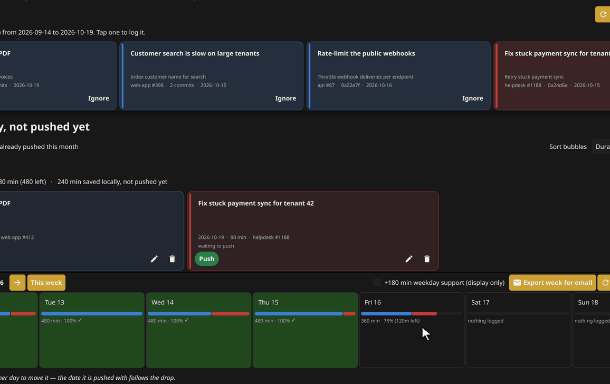
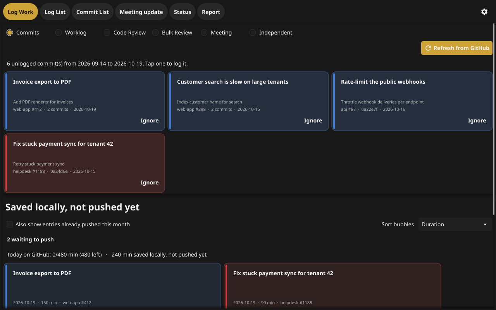
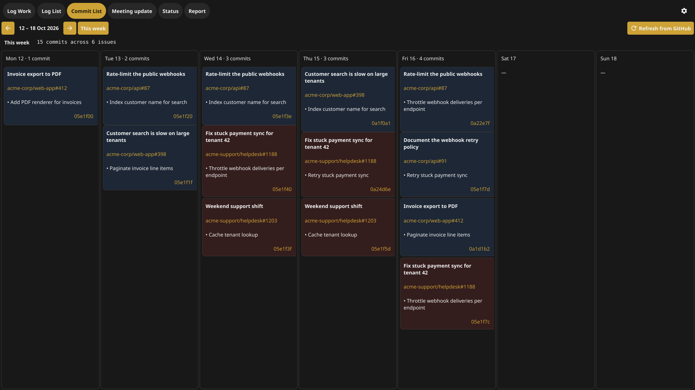
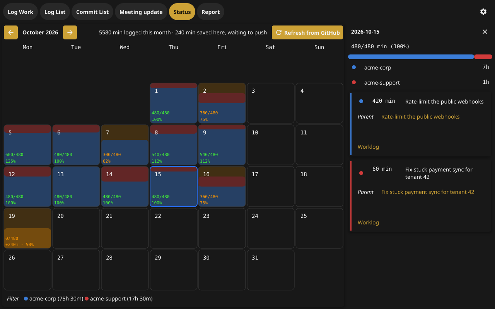
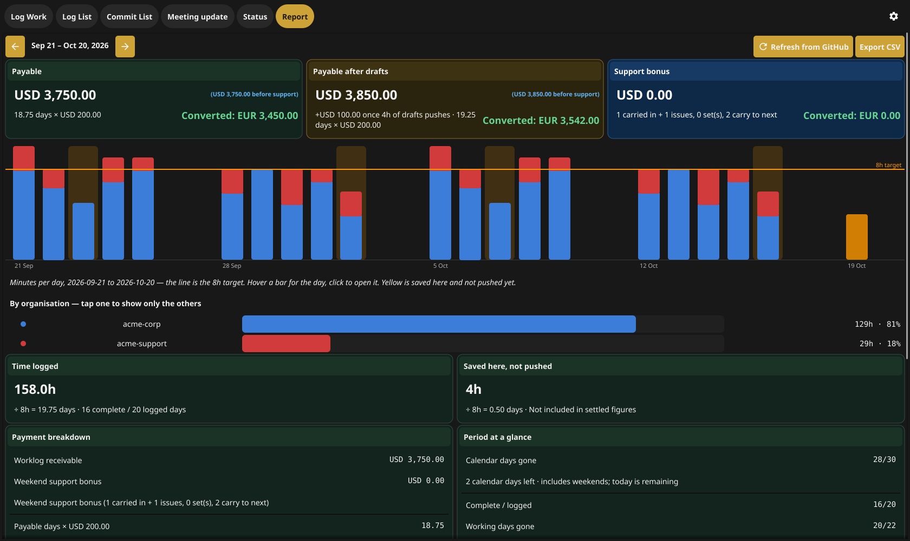
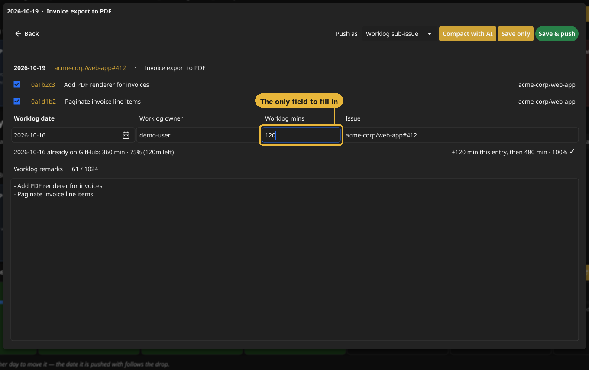
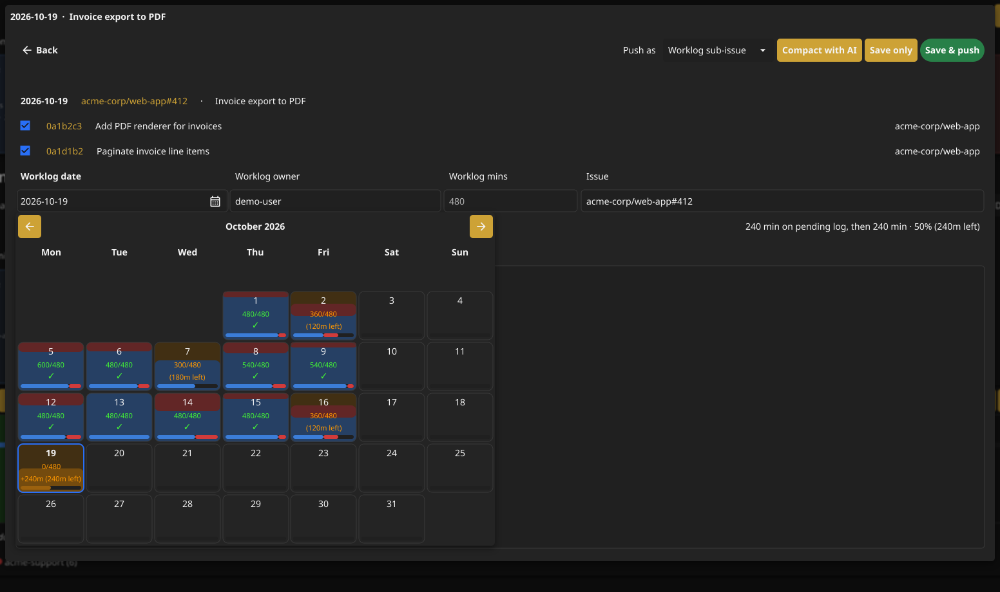
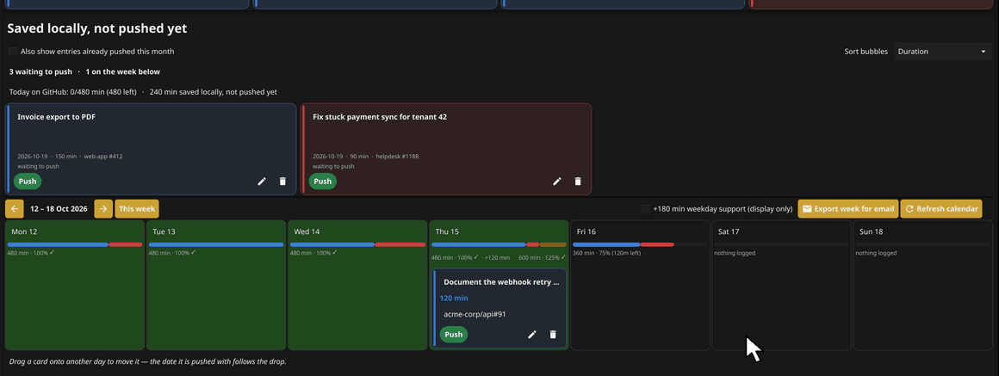

# Worklog



*Tap an unlogged commit, pick the day from the calendar — each day shows how
full it already is and what it still owes — and type the minutes. That is the
whole entry.*

A desktop app for logging work against GitHub issues and reading the result
back off a GitHub Project board.

It scans the commits you have pushed but not yet logged, turns each one into a
worklog entry, and pushes that entry to the project board as a sub-issue with
the date, minutes, owner and remarks filled in. The Status and Report tabs then
read those entries back from the board — a calendar of the month, and a payroll
period totalled against a daily target.

Built with [Fyne](https://fyne.io). All GitHub access goes through the
[`gh` CLI](https://cli.github.com), so the app never handles a token itself.

## Tabs

| Tab | What it does |
| --- | --- |
| **Log work** | Commits plus manual entries. **Code Review** accepts one PR URL, resolves its `Refs` issue and files the worklog there (a direct issue link also works). **Bulk Review** is a growing two-column PR-link/minutes sheet and creates one daily `<Name> Code Review: <date>` issue. |
| **Status** | A month calendar; each day fills towards the daily target, coloured by organisation. |
| **Report** | A payroll period — the 21st to the 20th — as stat tiles, a per-day bar chart, and the split by organisation. |
| **Settings** | Everything below. |

Tapping an organisation in any colour key hides its work across all three tabs.

<table>
  <tr>
    <td></td>
    <td></td>
  </tr>
  <tr>
    <td align="center"><b>Log Work</b> — unlogged commits, one tap to log</td>
    <td align="center"><b>Commit List</b> — the week by day and issue</td>
  </tr>
  <tr>
    <td></td>
    <td></td>
  </tr>
  <tr>
    <td align="center"><b>Status</b> — the month against the daily target</td>
    <td align="center"><b>Report</b> — the payroll period, totalled</td>
  </tr>
</table>

### Logging a commit

Tapping a tile on **Log Work** opens the logging popup. Everything except the
time is filled in for you: the date the commits were made, the owner from
Settings, the issue the commits reference, and remarks written from the commit
messages. **Worklog mins is the only field you have to fill in** — then
**Save & push**.



The line under the fields says how full the chosen day already is on GitHub and
what it comes to with this entry, so you can see whether the day is finished
before you push. To log against a different day, open the calendar on the date
field: every day carries its logged minutes and what it still owes, in the same
colours as the Status tab.



### Moving a draft to another day

Entries you save without pushing sit under **Saved locally, not pushed yet**,
and each one also stands on its day in the week calendar below. Each day shows
what is already on GitHub and what the drafts on it would bring it to. If an
entry landed on the wrong day, drag the card onto the right one: the day under
the card lights up, turning green when the drop would finish it. Letting go
moves the entry, and that is the date it is pushed with.



The screenshots and the animations are rendered off screen from made-up data —
no GitHub access, no real worklog. To regenerate them after a UI change:

```
DEMO_OUT=docs/screenshots DEMO_FRAMES=/tmp/worklog-frames go test -tags demo -run TestReadmeDemoFrames .
python docs/make_readme_media.py docs/screenshots /tmp/worklog-frames docs
```

## Requirements

- **Go 1.26** or newer
- **A C toolchain.** Fyne uses cgo, so a working `gcc` has to be on `PATH`.
  On Windows, [MSYS2/MinGW-w64](https://www.msys2.org) or
  [WinLibs](https://winlibs.com) — installed to a path with **no spaces in it**.
  A gcc under `C:\Users\Your Name\...` passes an unquoted path to the linker and
  every cgo build dies with `ld.exe: cannot find C:/Users/Your`.
- **`gh`**, authenticated. Two commands, not one:

  ```
  gh auth login
  gh auth refresh -s project
  ```

  The token needs `repo`, `read:org` and `project`. `gh auth login` grants the
  first two but **not** `project` — that is the scope the board is read and
  written through, so without the refresh the Log work tab still finds commits
  and every push then fails. Confirm with `gh auth status`; all three scopes
  should be listed.

## Build and run

```
git clone <this repo> worklog-go
cd worklog-go
go build -o Worklog .
./Worklog
```

On Windows, use the application build script (and optionally run the offline tests):

```
.\build.ps1 -Test -Output ..\Worklog.exe
```

This hides the console window and applies the application's hand-cursor policy
to Fyne buttons, checkboxes, radio options, dropdowns, popup menu items and tabs.
It also gives standard gold buttons contrasting dark labels and icons.
The script builds a private copy of the pinned Fyne version under `.build`;
it does not modify the shared module cache or the project's dependencies.
A plain `go build` uses Fyne's default cursors and button foreground colours.

> **Use `go build`, not `go run .`** — the app keeps its data in the directory
> the binary sits in, and `go run` builds into a temporary directory that is
> deleted afterwards, so everything you log is thrown away on exit. If you want
> `go run` for development, set `WORKLOG_DIR` first (see below).

### Where the data goes

In order of preference:

1. `$WORKLOG_DIR`, if it is set
2. the directory the executable is in
3. the current working directory

Three files are created there on first use. All three are in `.gitignore` and
none of them belong in a commit:

| File | Contents |
| --- | --- |
| `config.json` | your settings — **including the Anthropic API key, if you set one** |
| `worklog.csv` | every entry you have logged, remarks and all |
| `ignored.json` | the commit shas you have deliberately kept off the pending list |

Company repositories, board views, salary and support payments belong in local
Settings, never in source code. `config.json` is ignored by Git but is plain text,
not encrypted storage. GitHub Actions secrets are not used by this desktop app.
Do not commit the config or include it in release archives. Removing a value in
a new commit does not remove it from older commits.

When upgrading from a version with fixed meeting/review repositories, board
views or support payments, enter those values in Settings before using the
corresponding features. New installations leave these settings empty and assume
no salary or support payment.

## First run

The app starts empty and asks for nothing at launch — open **Settings** and
fill it in. Nothing is stored anywhere but the directory above; there is no
account and no server.

| Field | Notes |
| --- | --- |
| GitHub username | Optional. Blank means whoever `gh` is logged in as. |
| Worklog owner | The value written to the board's *worklog-owner* field, and what Status and Report filter on. |
| Repos or orgs to scan | Comma-separated. A bare `myorg` scans every repo in the org; `myorg/one-repo` scans just that one. |
| Worklog project URLs | One per line, e.g. `https://github.com/orgs/myorg/projects/9`. Status and Report read all of them. |
| Board view URLs | Optional saved views for weekly links, one per line. Preserves view parameters; blank uses the configured project URLs. |
| Meeting / Bulk review repository | Separate `owner/repo` destinations for daily meeting and bulk review issues. Required before pushing those kinds. |
| Base salary per 21 days | Drives the Report tab's rate. A period pays for 21 working days regardless of what the calendar says. |
| Support payment per set | Payment in the salary currency per seven qualifying issues. Blank means unset; incomplete sets still carry across periods. |
| Currency / Also show in | The second is converted with a rate fetched from `open.er-api.com`, at most once a day. |
| Look back (days) | How far back the pending-commit scan goes. |
| Default push mode | `subissue` creates a sub-issue under the referenced issue; `issue` writes the fields onto that issue directly. |
| Anthropic API key | Optional, only used by "Compact with AI" when remarks run past the board's 1024-character field limit. |

### What the board needs

The project the issues sit on must carry fields whose names start with
`Worklog` — the app matches on `worklog` + `date`, `owner`, `min` and `remark`,
case-insensitively. A `Status` field with a `Done` option is required for a
completed push; the app verifies the board item is Done before marking the
local entry pushed.
Without those fields an entry still pushes, and the app says which ones it could
not write.

## Tests

```
go test ./...
```

104 tests, all offline — nothing reaches GitHub, so a fresh clone runs green in
under a second. On Windows, if `gcc` is not the first one on `PATH`, point cgo
at the right one:

```
CC=C:/mingw64/bin/gcc.exe go test ./...
```

`live_probes_test.go` is the exception, and is behind a build tag for that
reason: it calls real GitHub with whichever org, project and issue were being
worked on at the time. Edit the refs to something on your own account before
running it.

```
go test -tags live -run Probe -v
```

`ld.exe: .rsrc merge failure: multiple non-default manifests` during a Windows
build is harmless — the binary is still produced. It comes from the embedded
icon resource in `rsrc_windows_*.syso`.
