# Worklog

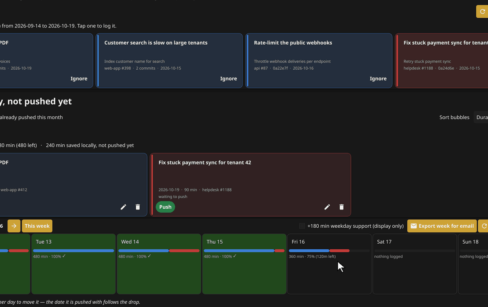

*Tap an unlogged commit, pick the day from the calendar — each day shows how
full it already is and what it still owes — and type the minutes. That is the
whole entry.*

A desktop app for logging work against GitHub issues and reading the result
back off a GitHub Project board.

It scans the commits you have pushed but not yet logged, turns each one into a
worklog entry, and pushes that entry to the project board as a sub-issue with
the date, minutes, owner and remarks filled in. The Status and Report tabs then
read those entries back from the board — a calendar of the month, and a payroll
period totalled against a daily target.

Built with [Fyne](https://fyne.io). All GitHub access goes through the
[`gh` CLI](https://cli.github.com), so the app never handles a token itself.

## Tabs

| Tab | What it does |
| --- | --- |
| **Log Work** | Log commits or use Worklog, Code Review, Bulk Review, Meeting, Independent and Create Weekend Support Slate. Save a draft locally, then push when ready. [Entry types below](#ways-to-log-work). |
| **Log List** | The week by day and issue: GitHub worklogs, local drafts, planned minutes, weekly progress, pending issues and **Export week** for an email summary. |
| **Commit List** | Browse pushed commits by week, grouped by day and issue, with links back to GitHub. |
| **Meeting update** | A Thursday-to-Thursday commit calendar beside the local worklog entries for the same eight days, ready for the weekly update. |
| **Status** | A month calendar; each day fills towards the daily target, coloured by organisation. |
| **Report** | A payroll period — the 21st to the 20th — as stat tiles, a per-day bar chart, and the split by organisation. |
| **Settings** | Identity, sources, organisation colours, salary, local storage breakdown and cleanup, historical GitHub backup, report range and app updates. [Storage guide below](#settings-storage-and-historical-backup). |
| **Kanban** | Issues and pull requests from your configured projects, with sprint dates and estimates. Filter by project or type; drag cards between statuses or onto a sprint to update GitHub. Drag a column's heading, or its check in the column filter (it lifts and follows the pointer), or click the menu icon at the filter's left (up and down per column), to reorder the columns; they slide into place and the order is kept. |
| **Sprint Calendar** | A local week/month/sprint calendar using Status styling, editable durations and drag-and-drop planning across multiple days. |
| **Projects** | All your saved projects, each built from parent issues: progress, workload, burn-up, weekly reports, forecasts, milestones, an editable issue list and a Gantt chart. [Full guide and GIFs below](#projects-all-your-projects-in-one-place). |

Tapping an organisation in the shared Log Work / Log List / Status / Report colour keys hides its work across those views.
Each key ends with Drafts Logs (yellow) and Planned Issues (purple), which hide
those the same way.

**Status** and **Report** each have a **Worklog** dropdown beside **Refresh from
GitHub**. It defaults to **Reported**, using **Worklog Reported(mins)**; choose
**Approved** to use **Worklog Approved(mins)** for that page's totals, calendar
or chart, and detail figures. Report's CSV uses its selected count too. Blank
approvals count as zero, and legacy board entries keep their single total.
Each page keeps its own choice while browsing and refreshing, and starts at
Reported again when the app opens. These two menus stay open after selection,
showing the animated gold row and check. Click outside, press Escape or click
the field again to close them. Saved locally and Log Work's date picker
continue to show reported minutes.

Option dropdowns throughout the app share the gold outline, rounded dark menu
and selected gold row with a right-hand check. The gold hover glides between
options; a click spreads gold from the pointer and draws the new check as the
menu automatically folds away, without a confirmation pause. The Worklog
selectors above stay open for comparing values. Search and keyboard selection
keep the same behavior.

### Reading bubbles, bars and colours

A **bubble** is a card for a commit group, saved entry, issue or planned block.
Its stripe and tinted background usually identify the issue's **organisation**.
Read its title, reference and badges for what it represents; the colour alone
does not tell you whether its minutes have been pushed.

| Where you see the colour | What it means and where it comes from |
| --- | --- |
| **Organisation stripe / card tint** | The owner in `owner/repo`. Defaults follow the order in Settings' repos/orgs, then any additional worklog-board owners: **blue, red, green, purple, amber, teal**, repeating. An unknown owner is grey. The **…** on an organisation chip in Settings > Sources opens its colour picker; your custom colour follows that organisation across the app. |
| **Organisation-coloured time segments** | Minutes already read back from GitHub. These use the organisation mapping above, even when the corresponding entry's bubble has a special colour. |
| **Yellow / gold time segment** | A draft saved on this computer that has not been pushed. The legend calls these **Drafts Logs**. |
| **Purple time segment or `…m planned`** | Local blocks on the **Sprint Calendar**, counted on the date they are scheduled. The legend calls these **Planned Issues**. They remain planned until you change or remove the blocks; logging the same issue does not subtract them. |
| **Purple Meeting, Bulk Review or Independent bubble** | These entry types create their own issue on push. Their purple styling stays after an issue reference is assigned. A regular Worklog or single Code Review follows its parent issue's organisation colour. |
| **Purple outlined `Code review` badge** | A single Code Review entry, distinguished from ordinary development work. This badge describes the kind of work. |
| **Maroon outlined `Missing Meeting Recording` badge** | A meeting without a recording link. The link is optional: the badge is a reminder and does not block saving or pushing. |
| **Turquoise checkbox, `Support Week`, `180m support` or bar segment** | The **+180 min weekday support** preview described below. This is a fixed support colour, separate from organisation colours and local draft yellow. |
| **Blue weekend-support controls / bonus tile** | **Weekend** support slate creation and the earned support bonus on Report. This is separate from the turquoise weekday preview. |
| **Green day background** | The daily target is **480 minutes / 8 hours**. Stronger green means GitHub already holds the target; paler green means the day reaches it when pending drafts, support or plans are included. A yellow short-day warning means some time is logged but the target is still short. |
| **Light blue date during planning** | A possible drop date within the issue's sprint with enough free time. Gold marks the hovered destination and today's outline. |
| **Gold controls** | Local actions and reads, selected tabs and navigation. **Green pill buttons** write to GitHub or confirm an update/choice; **red buttons** remove or discard something. |

Kanban **column colours** describe board status, independently of a card's
organisation stripe: Created grey; Analysis - Investigation dark blue;
In Progress yellow; Pending Customer Feedback dark purple; Pending Test orange;
Server Update Required pink; In Review purple; Done green.

Projects' **charts** have their own named series: green for Done, amber for
In Progress/open workload, blue for Review/Test, pink for To do, violet for
Backlog and orange for Blocked. When several statuses share a class, the status
ring assigns distinct spare colours; read its legend. Finished-report colours
identify **people**, not organisations. Gantt's gold bars with green outlines
and green links mark the critical path. These chart colours do not come from
the organisation colour picker.

Click a pending commit bubble to open its logging form, or a saved entry to
edit it. Drag a draft in Log Work to change its date. Kanban bubbles can be
dragged between statuses/sprints to update GitHub; Sprint Calendar bubbles
create or move local plans. In Projects, clicking a figure opens its issues as
bubbles with a GitHub title link, status/priority, repository/sprint, assignees
and issue age. Hovering brightens a bubble; it does not change its state.

### Weekday support: what the +180 checkbox does

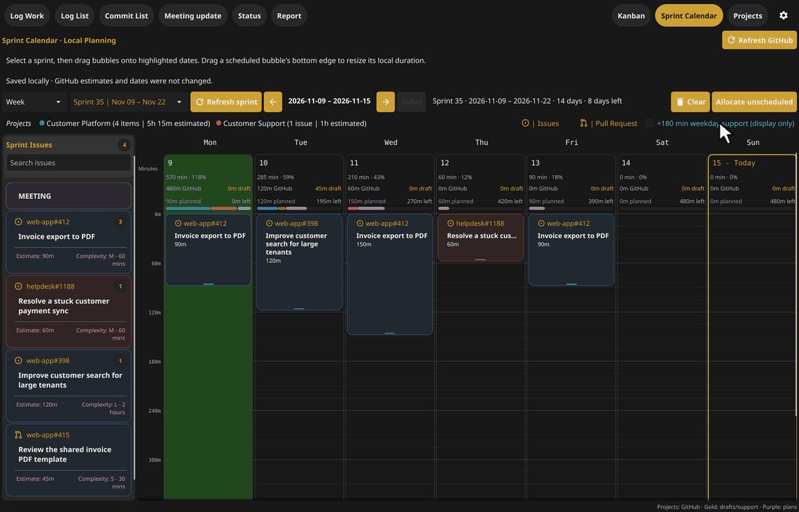

**+180 min weekday support (display only)** previews a **3-hour shift on each
weekday**. For example, **300 minutes logged + 180 support = 480 minutes** in the
projected reading. The logged amount remains 300 until you actually log and push
that support work.

- The control appears in Log Work, Log List and Sprint Calendar. Its selected
  weeks also feed Status, Report and the logging date picker. Report shows the
  preview in its bars and projected pay, separately from earned amounts.
- In a week view it applies to that week. Sprint Calendar applies it to the
  weeks touched by the displayed Week, Sprint or Month range. Saturdays and
  Sundays receive no placeholder minutes.
- If GitHub already has your weekly-support rota slots, the checkbox becomes
  a turquoise **Support Week** label. An empty weekday slot supplies the preview
  automatically. Matching uses the configured display name (or the name derived
  from Worklog owner) at the beginning of the issue or parent title, such as
  `Alex: Weekly Support …`.
- A support shift with **positive minutes already logged** suppresses the
  extra 180 for that date; a zero-minute rota slot does not. Sprint Calendar
  also avoids adding the preview over a real weekly-support block planned on
  the same date.
- Manual choices are remembered per week in `support-weeks.json`, including
  when switching tabs or reopening the app. They are cleared after that week's
  Friday, or when all five weekdays have logged support. Unticking removes a
  manual preview; rota-derived support follows the board data.

The preview creates no worklog row, issue or plan block and pushes no minutes.
It is separate from **Create Weekend Support Slate** and Report's bonus for
sets of seven qualifying weekend-support issues.

### Projects: all your projects in one place

Open **Projects** at the right of the menu bar. Each saved project gets its own
tab; it follows the child issues of one or more GitHub parent issues (epics).
These saved projects are separate from the board-source list used by Kanban.

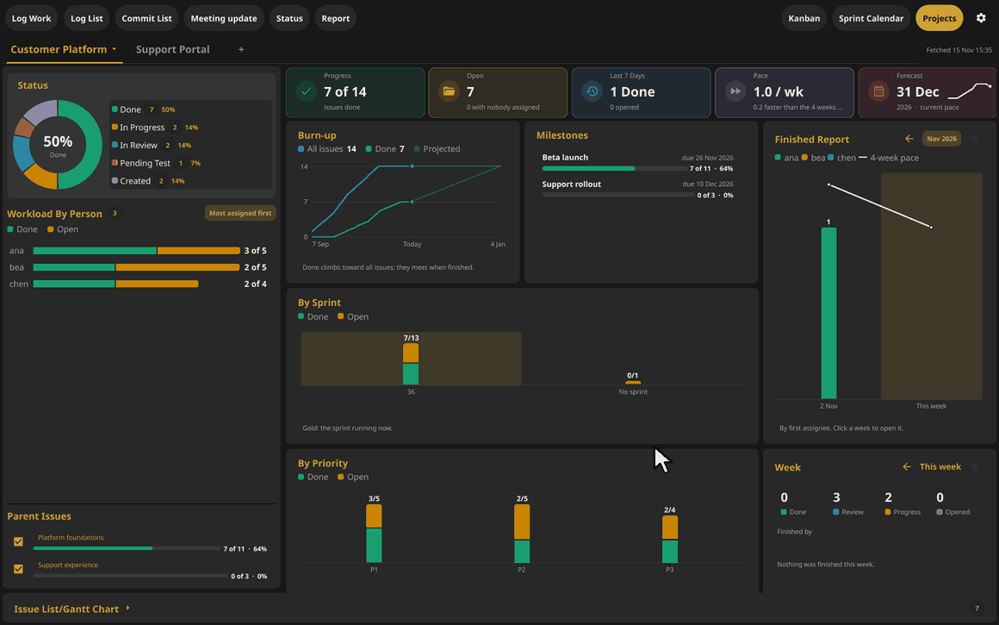

**Set up and manage projects**

1. Click **+** (or **Add a project** on an empty page), enter a name and paste
   parent issue links or `owner/repo#123` references. Multiple parents are useful
   for large projects: a GitHub issue can hold 100 child issues. The link box
   grows as you paste.
2. The page fetches the children, their board fields, assignees, milestones and
   blockers. A parent that cannot be read shows its own error while the other
   parents still load. The fetched timestamp tells you how fresh the page is.
3. Drag project tabs to reorder them. The leftmost project opens on the next
   start. Open the arrow on the selected tab for **Edit project**, **Refresh
   from GitHub**, **Export CSV** and **Delete project**. Deleting here removes
   the local saved project.
4. Gold ticks beside **Parent issues** include/exclude each parent's children
   from the figures, drill-downs and issue list. This scope choice and the tab
   order are saved in `projects.json`.

**Read the dashboard**

| Panel or tile | How to use it |
| --- | --- |
| **Progress / Open / Last 7 Days** | Completed issues, remaining issues (including how many have no assignee), and recent finished/opened counts. Click a tile to inspect its issues. |
| **Pace / Forecast** | Recent issues finished per week and the estimated finish at that pace. Forecast opens alternative historical paces, the effect of new issues arriving, and a calculator: choose a finish date for the required pace, or type a pace for its finish date. These are issue counts, not estimated hours. |
| **Status ring** | The board-status split, including Not planned. The ring includes board-Done issues even if still open on GitHub; the Progress tile and finished history use completed issues. A GitHub-closed issue with an active board status still counts as open work. Click a legend row for its issues. |
| **Workload by person** | Assigned Done/Open work per person, plus Unassigned. Switch between most assigned and most done; click a person to inspect their issues. An issue with several assignees appears for each, so person totals can exceed the project total. |
| **Burn-up** | All issues versus Done since the start, with a projected continuation where a forecast is available. Completion is where the lines meet. Hover a week for its cumulative count and the issues opened/finished that week. |
| **Finished report** | Issues finished each week, coloured by first assignee, with the 4-week pace line. Arrows page through months; click the month label to show every week, and click again to restore the paged view. Settings > Finished report range controls months per page. Click a week to select it in the Week panel. |
| **Week** | Done, In review, In progress and Opened for the picked week, plus who finished them. Use the arrows to walk weeks and click the figures for the matching issues. Historical review/progress counts are snapshots recorded when this app refreshed that week; GitHub supplies no status history to fill missed weeks. |
| **By sprint / By priority** | Issue counts split into Done/Open, using board fields (priority can also come from a `P1` or `priority: …` label). Click a column for issues grouped by state and assignee. Sprint date ranges appear with their labels. |
| **Milestones** | Done/total and due dates, including overdue dates and issues with no milestone. Click a milestone to inspect its issues. |

Closed-as-Not-planned/duplicate issues are shown separately and excluded from
active scope and completion pace. A displayed board status still tells you why
an issue ended, such as Duplicated or Request denied.

**Issue list and Gantt chart**

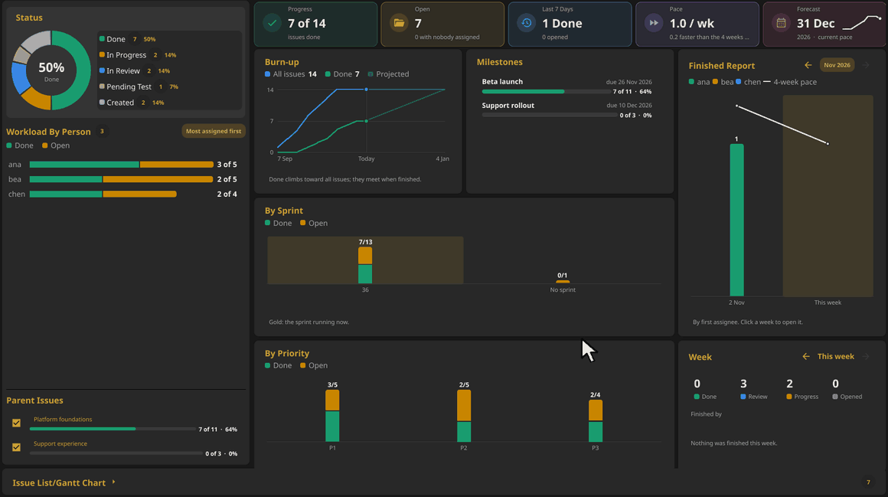

The **Issue List/Gantt Chart** heading under the dashboard starts folded.
Click it to unfold the section; the page scrolls along as it opens.

- **Issues** groups rows by milestone. Search issue text, people, status or
  sprint; **Open / Done / Not planned / All** narrows the same data. The first
  150 matching issues are drawn; narrow the search for a larger project.
- Click a column heading to sort ascending, again for descending and a third
  time to restore **Sprint** order. Issues with no value sort last.
- **Assignee, Status, Priority and Sprint** are searchable selectors. Choosing
  a value writes to GitHub, then updates the page; Status uses its Kanban
  colour. Available assignees come from the repository plus people already on
  the project. This is the part of Projects that changes GitHub.
- **Gantt** uses the same search and state filters and groups by milestone.
  A scheduled issue's bar spans its assigned sprint. An issue without sprint
  dates shows opened-to-closed/today. An issue with neither a sprint start nor
  an opened date is labelled **Unscheduled · no dates**. A milestone due date
  is a gold marker, not an invented task schedule.
- Arrows show actual GitHub **blocked-by** links when both issues are in view.
  The critical path uses **gold bars, green outlines and green links** and stays
  visible; hover an issue to see its other links and date/blocker details.
  Clicking a row opens that issue's bubble. The chart is a read-only timeline.
- **Export CSV** beside the filters exports every matching issue, including
  matches beyond the 150 displayed rows. A drill-down popup exports its list;
  the project menu exports the scoped project. Files go under `data/exports/`.

### Kanban and local sprint planning

The **Kanban** and **Sprint Calendar** menus are grouped on the right side of
the menu bar. Both reuse the organization colors and striped bubbles from
Log Work, including custom colors from Settings.

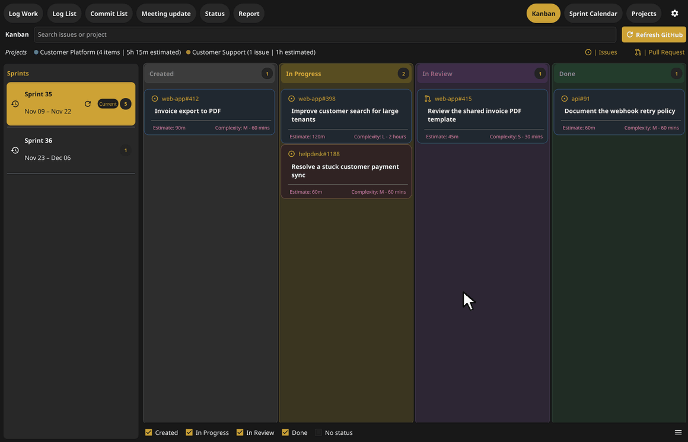

*The icon-and-text filters on the right of Projects toggle Issues and Pull
Request independently. Your type and column choices are remembered locally.*

**Kanban** reads the project URLs and per-board filters under Settings > Sources
> Kanban boards and filters. Existing installations start from their worklog
project URLs with `assignee:@me is:open`; shared GitHub views are never read.
Add/remove boards and edit each filter independently. A blank filter reads all
items in the project. Removing all sources disables board fetching.
It opens on the current sprint; click a sprint in the sidebar to select it and
click it again to show all items. No Sprint is a compact row. Thick rows combine matching sprint
dates across projects, hide zero counts and group older sprints under Completed.
Done issues and pull requests are fetched for the current **and previous**
sprints, including closed items excluded by an `is:open` or `-status:Done`
source filter. Assignee, repository and label constraints still apply. Expand
**Completed** and select a past sprint to see its Done column and counts;
**Refresh sprint** updates that sprint's open and Done work together.
The project legend in either menu combines item counts and estimated time
with the project toggle. Selected sprints have a gold fill; the Current badge
keeps its gold outline. No Sprint uses gold text and a gold fill when selected.
Unselected sprint rows blend into the page, with visible grey dividers between
them. On Kanban, the icon-and-text type filters share the Projects row on the
right; click either to hide or show that type. Both types start enabled. Choices
are saved as `KanbanTypes` in `sprint-planner.json`, including hiding both.
A column, and the Sprint Calendar's Sprint Issues list, shows each project's
first card, then each project's second, and so on. Drag a chip along either
menu's legend to choose which project comes first in each position; both menus
share the order, saved as `ProjectOrder`. Every project starts shown; switching
one off in a legend lasts until the app closes.
Refresh GitHub sits
on the right with its icon. The default columns are Created (grey), Analysis - Investigation
(dark blue), In Progress (yellow), Pending Customer Feedback (dark purple),
Pending Test (orange), Server Update Required (pink), In Review (purple), and
Done (green). The gold checkboxes beneath the board include every status,
including the ones currently displayed. These choices are saved in
`sprint-planner.json` as `KanbanColumns`, including an empty selection. Their controls sit beneath the
board rather than the sprint sidebar. Status colors appear in softly tinted
column backgrounds, quieter full-column outlines and header
text. Kanban cards retain their original project-colored fill and stripe,
show a gold issue or pull request icon beside a small `owner/repo#number`,
which links to the issue or pull request, then the complete title. Estimate and
complexity appear on separate pink lines. When no sprint is selected the
card's sprint sits at the bottom as a green tag.

Changes made on the board are saved to GitHub one at a time, in the order you
make them, so you can keep dragging while earlier saves run. A card waiting its
turn is drawn where it is going, marked **Queued**. Moving it again before it
is sent replaces the queued change, and moving it back cancels it. If GitHub
refuses a change, only that card goes back and the rest still save. Refresh
GitHub waits until the queue is empty. Closing the app with changes still
queued asks first, and a GitHub call that does not answer within three minutes
fails rather than holding up the queue.
Columns expand to fill the space beside the fixed sprint sidebar; many columns
retain horizontal scrolling at a readable minimum width.
Drop a card onto a status or sprint to update that field in its source project.
Clicking a card also provides status and sprint selectors. Direct links open
GitHub without opening the editor first.
The editor places GitHub fields and local planning controls in two columns
without an outer scrolling page.

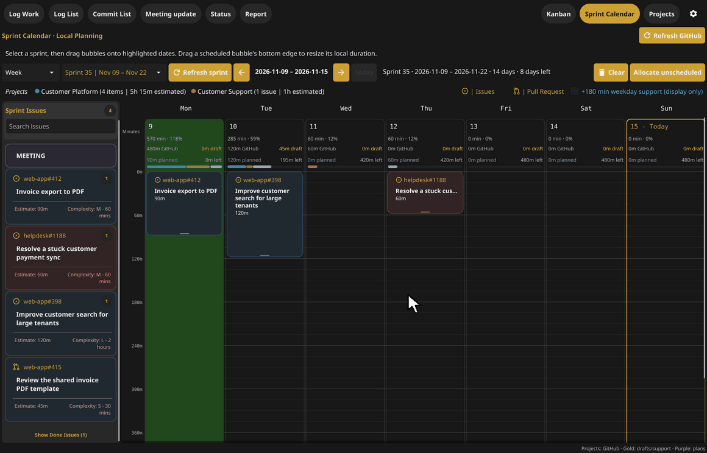

*Plan the same issue on several days and resize each bubble by its bottom edge.
Purple shows planned time, gold shows local drafts, turquoise shows the
weekday-support preview, and organisation colours show time logged on GitHub.*

**Sprint Calendar** has a sprint dropdown for current, future and completed
sprints alongside **Week**, **Sprint** and **Month** view modes. Sprint choices
show the title and dates, with gold text for the current sprint. Both calendar
dropdowns use gold filled rows for their selected options. The selected sprint
is centered when opening its dropdown, including the first and last choices. Checkboxes, dropdown
opening/hover feedback animate. Today has a gold
outline and `- Today` label. Sprint view
shows the selected sprint's full date range. Selecting a sprint moves the
calendar to its dates. Both selections are saved locally; the view is written
to `CalendarMode` in `sprint-planner.json` and restored when the app starts. Every bubble is
retained in month view; rows grow to fit their issues, share unused viewport
height and scroll when needed. Week view expands the minute scale and bubbles
together to fill spare height; month rows keep their compact scale. Month wheel
and trackpad scrolling moves six times faster. Every date shows its minutes,
percentage, and a progress bar at the top. This reads actual GitHub worklogs
from the same configured sources, owner filter, and monthly cache as Log Work.
Opening the calendar loads every month in the displayed range; Refresh GitHub
refreshes both the issue boards and worklogs. Saved unpushed Log Work rows are
included as drafts. Organisation colours mean GitHub minutes, gold means
drafts, turquoise means weekday support, and purple means planned minutes. A plan is independent of
logged and draft time: work logged on GitHub or saved in Log Work against the
same issue never reduces it. A local completion checkbox never fabricates
GitHub time. Dates label
all three readings. Full logged days have a stronger green background; days
that reach the target through drafts or plans use Log Work's lighter green.
The shared ruler on the left measures planned minutes per day, starting at 0m,
with labels every 60m and grid marks every 15m. Bubbles stack in position
order and their heights represent their durations. Blocks have no time of day:
each day keeps its bubbles in a saved position order, and dragging a bubble
between two others on a day puts it there.
Drag the bottom edge inside a scheduled bubble to stretch it in 15-minute steps.
There is no separate resize panel. Resizing changes only that bubble's minutes,
refuses a day past 24 hours, and keeps the calendar's scroll position. Manual duration
entry also requires 15-minute increments. The day's background turns green
at the daily target; today's outline is gold.
Hover over an issue in the left sidebar to preview eligible dates. Scheduled
bubbles highlight dates only while held for moving; resizing shows no drop
highlights. During a drag, only dates inside its sprint with
enough free time light up in translucent light blue, with a gold outline on the
hovered date. Every active sprint issue stays in the left sidebar after scheduling;
drag it again to add a block on another day. Drop a tray bubble to create a
new time block, or drag a scheduled bubble
to move that block while preserving its duration. The month scrolls when a
carried bubble reaches the top or bottom edge.
**Clear** confirms before removing local blocks from the selected sprint's
visible projects. It keeps local estimates, notes, other sprints and GitHub data.
These confirmations and Log Work Delete use compact modals with buttons
anchored at the bottom: red pill-shaped removal actions and gold rounded Cancel.
Hover over a planned day to reveal a small red **Delete** beside its date
immediately, without clicking; the day header is repainted when it appears or
disappears. It clears only that date after confirmation. Hovering a scheduled
bubble shows the same **Delete** at its top right, which removes only that
block after confirmation, keeping the issue's other blocks, estimate and notes.
Sprint selection and redraws preserve the Kanban sidebar,
calendar, and sprint-issue sidebar scroll positions. Calendar modes remember
their own positions when switching between Week, Sprint, and Month.

**Refresh sprint** refreshes the selected sprint's board items. The sidebar's
search narrows its issues, and **Show Done Issues** unfolds completed ones.
Its gold count badge tells you how many blocks you have already planned for
that issue. Drag sidebar issues to reorder them; drag a project chip to change
the shared project ordering. The Issues/Pull Request controls filter the
calendar's item types independently from Kanban. Blocks already planned from
other sprints stay visible on their dates when you change the selected sprint;
each block still obeys its own issue's sprint when moved.

The turquoise **+180 min weekday support (display only)** control adds a
weekday projection, or shows **Support Week** when your rota is detected.
See [weekday support](#weekday-support-what-the-180-checkbox-does) for its
matching, saved-week choices and duplicate prevention.

Click a bubble to edit local effort, complexity, notes, completion and time
blocks. Duration defaults to the project's Estimated Effort (Mins), then its
complexity scale (10/30/60/120/240/480 minutes), or 60 minutes when neither is
set. New time blocks round up to the next 15 minutes; the source estimate stays
unchanged. Existing saved durations are retained until edited. Local durations
can exceed the GitHub estimate without changing GitHub.
**Allocate unscheduled** fills each weekday up to 8 hours after its existing
blocks, keeps those blocks, and splits long tasks across days. Issues that cannot fit before
the sprint ends remain unscheduled. Manual blocks must fall inside the issue's
assigned sprint and fit in what is left of the day's 8 hours.

The local schedule, overrides, display mode and filter/order preferences
are stored in `sprint-planner.json` beside the app's other data. Board snapshots
are kept in memory and fetched again after restarting. Scheduling, resizing and
local completion do not create GitHub worklogs or change estimates.

There is one automatic board update: at startup or when Sprint Calendar opens,
an issue planned for **today** that is still **Created** can move to **In
Progress**, if that board offers the status. The app fetches the board first
and tries each issue at most once per session. Kanban drags and its explicit
**Apply status/sprint** controls also update GitHub. Local blocks on past dates
are pruned as the planner is maintained; it is a forward plan, not a historical
worklog. Log completed work through Log Work to retain it as worklog history.

Board configuration is stored in `config.json` as a `kanban_boards` array of
objects with `url` and `filter` text fields.

The Log Work pending-commit search matches issue titles, references and commit
text. The same query filters saved entries and the Log Work calendar.

### Settings, storage and historical backup

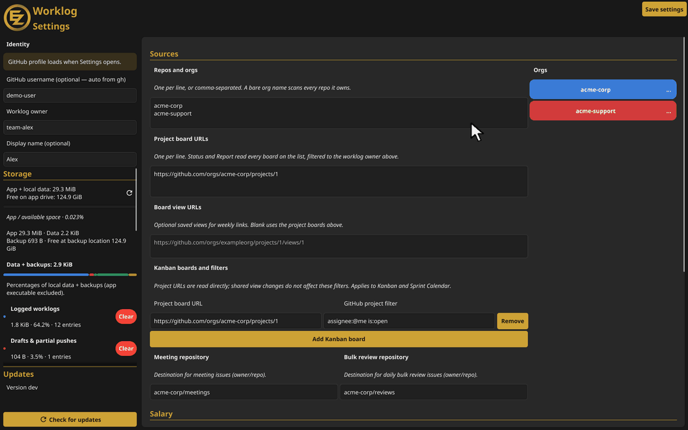

Identity stays fixed at the top of the left sidebar and **Updates** floats at
its bottom, inside a rounded grey panel with a gold heading. Storage and History
backup scroll behind the Updates bubble, as cards do behind a Kanban column
heading. The right-hand form scrolls independently, with **Worklog**
and **Projects** side by side and a gap between them. New storage controls use
smooth hover feedback and the same button roles as the rest of the app.

Use the three-dot control on an organisation colour chip to open its colour
picker, including advanced custom colours. Colours apply across the app and
are saved in `org_colors`. Successful saves show a small bottom-left toast.

**Preserve worklogs before the new SOP**

1. Set the Worklog owner and worklog project URLs, then click **Back up from
   GitHub** in the sidebar. It fetches every matching record from **1 July
   2025 through 20 November 2026**, or through today if earlier, across all
   configured boards. Refresh on or after **20 November 2026** to include the
   complete final day before the SOP changes on the 21st.
2. The readout shows record count, covered dates, last fetch, compressed size,
   location and free space. A failed board fetch does not replace the backup
   with a partial result. Refreshing retains previously saved records that
   later disappear from GitHub.
3. Open **…** beside the backup button for **Reallocate backup** or **Clear
   backup**. Reallocate opens a review dialog with **Choose folder**; Windows
   uses the normal File Explorer folder picker. The app verifies the new copy
   and saves its location before removing the old one. Clearing asks first.

The compressed backup is scoped to your owner and configured worklog boards.
It supplies covered, completed historical days to **Status, Report and Log
List**; today and uncovered dates still read GitHub. Existing archived days can
be refreshed by a backdated push. Worklog field reads prefer populated current
fields and accept matching `ZZZ (DEPRECATED)` fields when needed. Once a date
is backed up, its historical report no longer depends on those old board fields.

| Data or view | Preserved by the GitHub history backup? |
| --- | --- |
| Fetched worklog dates, owners, minutes and remarks | Yes, within the backup's covered range. |
| Linked issue titles, descriptions, URLs, parent details, status and assignees | Yes, as fetched with the worklogs. These support historical report cards. |
| Commit List and Meeting update's commit calendar | No commit archive. They continue fetching commits from GitHub. |
| Local drafts, saved entries/calendar cards and commit logged markers | No. These depend on `worklog.csv`; the archive does not restore that file. |
| Projects' weekly review/progress snapshots | No. These are separate local history in `projects.json`. |
| Ignored commits, sprint plans and support previews | No. These remain in their own local files. |

**See and clear local storage**

The slim gold bar compares the app executable plus local data with free space
on the app drive. Backup size and free space at its location are shown
separately. The coloured **Data + backups** bar breaks down stored data by
category; these percentages exclude the executable and are not whole-drive
usage percentages. Each category has a distinct, stable colour. Click the
gold, underlined **Data + backups** heading or its far-right arrow to fold or
unfold the breakdown with the same slide
animation as Log Work's Saved locally section. The breakdown starts collapsed.
Storage, Data + backups and History backup have extra top padding to separate
the sections. The storage refresh icon is gold.
Your preferred backup folder is saved for later backups, including after you
clear an archive.

Each clearable category has its own red **Clear** button and confirmation:
logged worklogs, drafts/partial pushes, ignored commits, Projects report
history, sprint plans, issue lookup cache, support placeholders, saved exports,
the GitHub history backup and a legacy worklog backup if present. Settings and
other metadata are marked **Kept**. No clear action deletes GitHub records.
Clearing logged rows can make commits appear pending again and removes their
local cards; clearing drafts or Projects snapshots loses data the GitHub
backup does not contain. Read the confirmation before clearing a category.

<table>
  <tr>
    <td>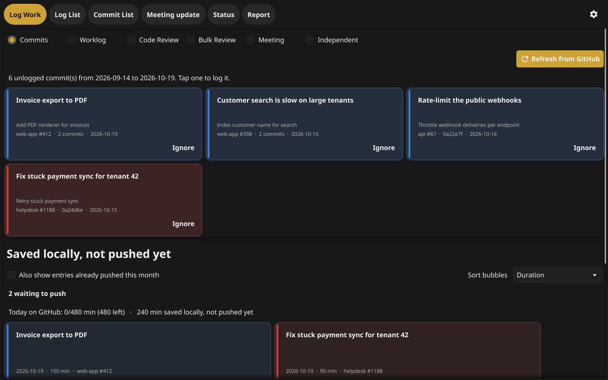</td>
    <td>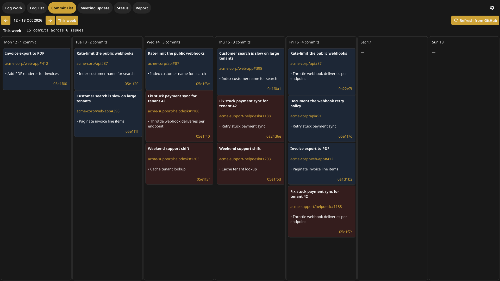</td>
  </tr>
  <tr>
    <td align="center"><b>Log Work</b> — unlogged commits, one tap to log</td>
    <td align="center"><b>Commit List</b> — the week by day and issue</td>
  </tr>
  <tr>
    <td>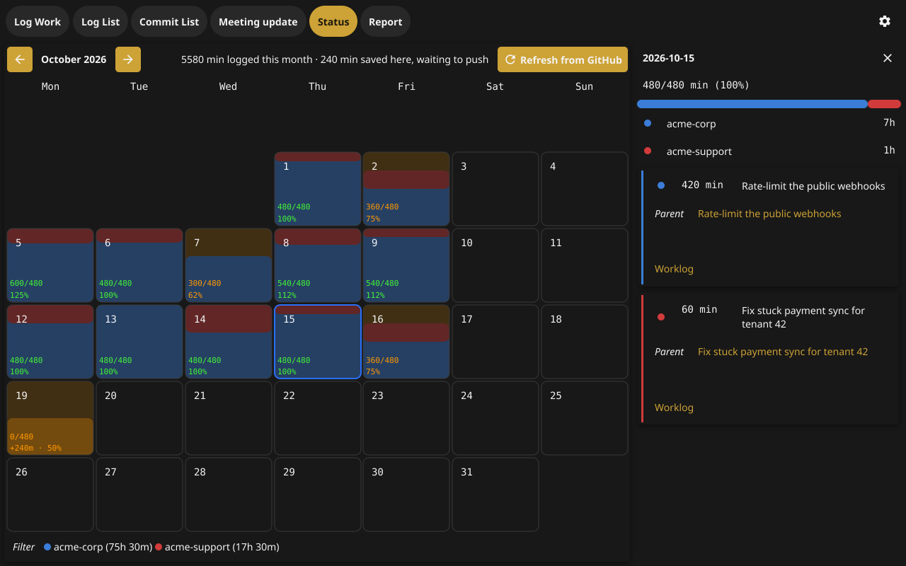</td>
    <td>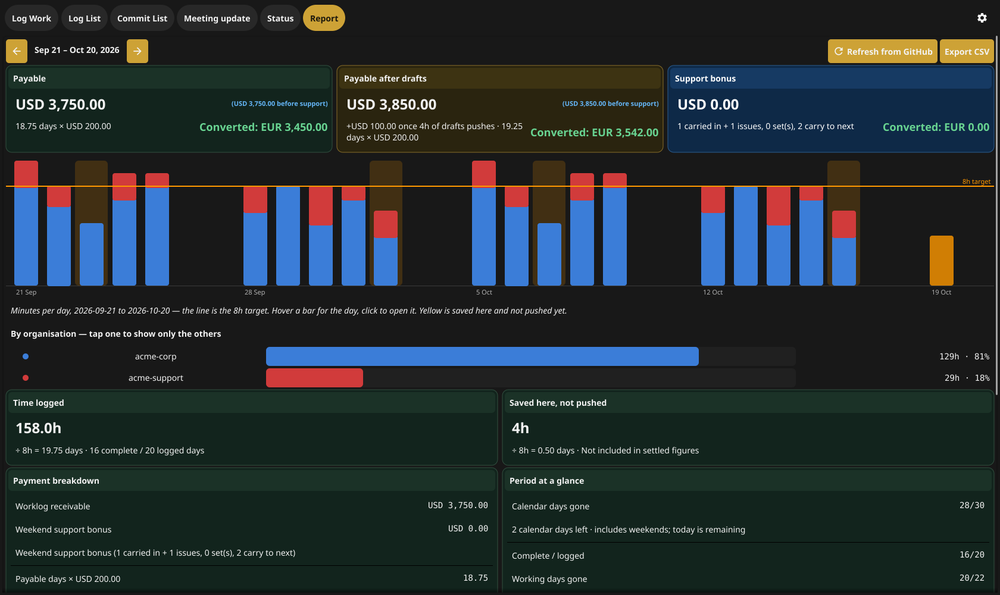</td>
  </tr>
  <tr>
    <td align="center"><b>Status</b> — the month against the daily target</td>
    <td align="center"><b>Report</b> — the payroll period, totalled</td>
  </tr>
  <tr>
    <td>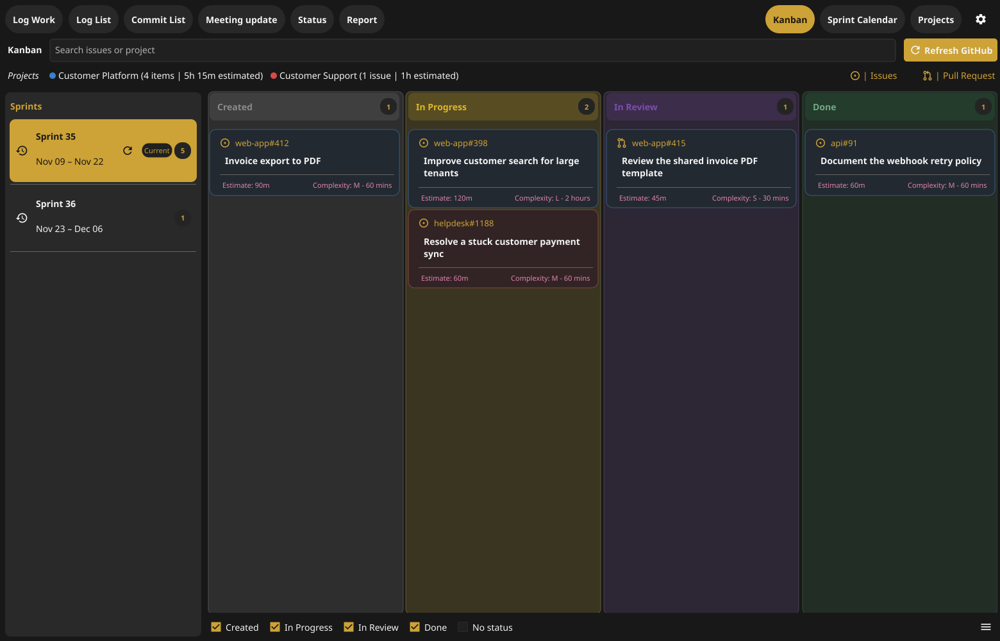</td>
    <td>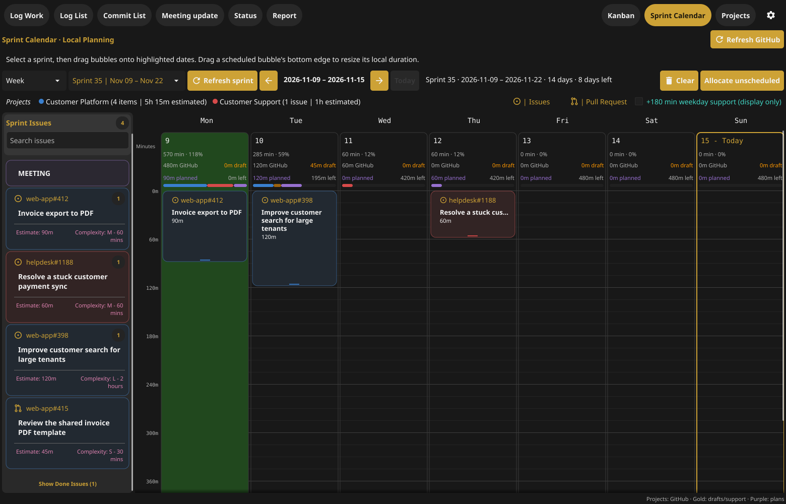</td>
  </tr>
  <tr>
    <td align="center"><b>Kanban</b> — issues and pull requests across projects</td>
    <td align="center"><b>Sprint Calendar</b> — plan locally in 15-minute steps</td>
  </tr>
  <tr>
    <td>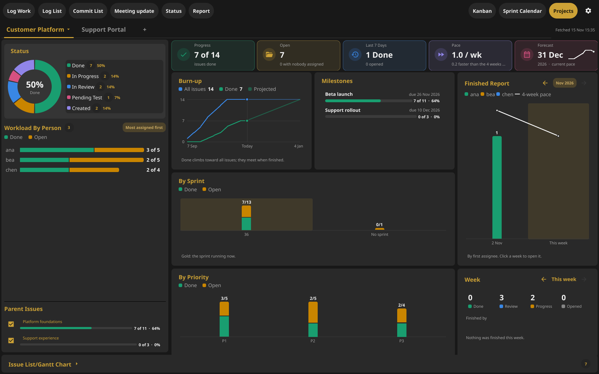</td>
    <td>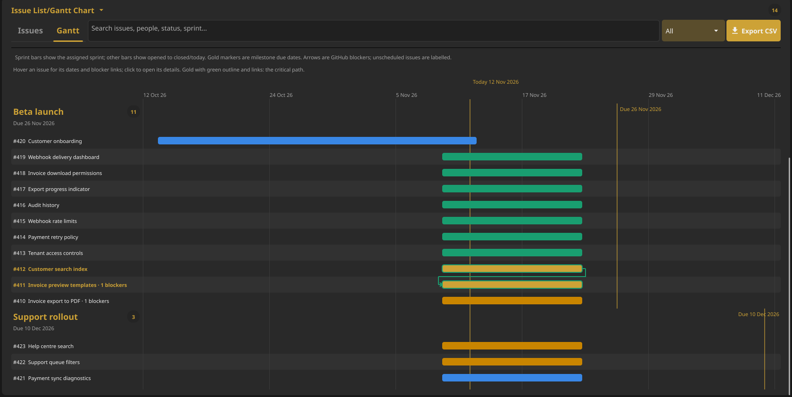</td>
  </tr>
  <tr>
    <td align="center"><b>Projects</b> — the whole project on one dashboard</td>
    <td align="center"><b>Gantt</b> — sprint dates and GitHub blockers</td>
  </tr>
</table>

### Ways to log work

The subtabs inside **Log Work** choose where an entry is filed. Every issue/PR
field accepts `owner/repo#123`, `owner/repo/issues/123` (or `/pull/123`) and full
GitHub links.

| Entry type | When to use it |
| --- | --- |
| **Commits** | Pushed commits grouped by date and referenced issue. Open a bubble, enter minutes and save or push. **Ignore** hides a group without claiming time; **Show ignored** lets you restore it. Commits whose subject starts with `chore` (such as `chore(ng21): …`) start out ignored. |
| **Worklog** | Manual work against an existing issue. Paste the issue, enter minutes and remarks; pushing creates a Worklog sub-issue. |
| **Code Review** | One PR: the app resolves the issue named by its `Refs`. If several issues are referenced, choose one beside the link. A direct issue works too. The entry carries a purple Code review badge. |
| **Bulk Review** | A growing two-column PR/minutes sheet. It totals the rows and creates one daily `<Name> Code Review: <date>` issue in the configured bulk-review repository on push. |
| **Meeting** | Meeting and ad-hoc time with an editable issue title, notes and optional recording link, filed in the configured meeting repository. |
| **Independent** | Work with no existing issue: choose a repository, enter the new parent issue's title and description, then the worklog details. The parent and its worklog are created on the first push. |
| **Create Weekend Support Slate** | Paste the team's support epic, choose the week and mark any weekday public holidays. The green creation action writes your own weekly epic and seven blank daily worklogs to GitHub. Weekdays cover before/after office hours; weekends and marked holidays cover the full day. Running again reuses matching titles, so a partial run can be completed. |

**Save locally** keeps a draft under **Saved locally, not pushed yet**; **Save &
push** sends it to GitHub. Drafts can be sorted by duration or earliest creation.
The same search narrows pending commits, saved entries and the Log Work calendar.
The remarks editor counts towards the board's 1024-character limit. At the
limit, **Separate worklog remarks** offers an animated checkbox; selecting it
slides a second field in from the right. Edit the copy in that field to fit
the remarks limit while keeping the full issue description.
Regular worklogs, commits and single Code Reviews create sub-issues. Existing
entries keep their original target when re-pushed. Every pushed worklog uses
the **Worklog** GitHub issue type and writes the same minutes total to the
issue's **Worklog Reported(mins)** field and the project's worklog minutes field,
including its deprecated version. A failed type or field update keeps the row
retryable. Editing the saved popup's local description also updates its bubble
title without renaming the parent issue on GitHub.

Entries dated today or in the past can be pushed; future drafts wait until
their date. A late Worklog's description starts with **Logged for YYYY-MM-DD**,
then a blank line and the work details. The date is kept out of worklog remarks
and is not duplicated on retry; retries move older footer dates to the top.
Status, Report and Log List count late Worklogs on that logged-for date, even
when pushed after the selected month or payroll period. Both Reported and
Approved totals use it. Plain first-line dates on Worklogs created outside the
app are recognised too, as are the app's older footer dates. Worklogs without
a date note use their Malaysia creation day; GitHub's creation timestamp stays
on the actual push day.

The SOP allows up to **15 hours / 900 minutes logged per day**. Status and
Report retain those logged hours; **payable time is capped at 480 minutes /
8 hours per day**, across all that day's Worklogs. Additional logged hours do
not increase that day's pay. Both Reported and Approved use the same pay cap.
Backfill follows each Worklog's **Logged for** date before applying that cap.
For example, 300 minutes on Monday plus a 180-minute Worklog created Tuesday
but marked **Logged for Monday's date** completes Monday's 480 minutes. That
Worklog is counted once, on Monday. Unmarked excess stays on Tuesday and does
not fill another day's shortage.

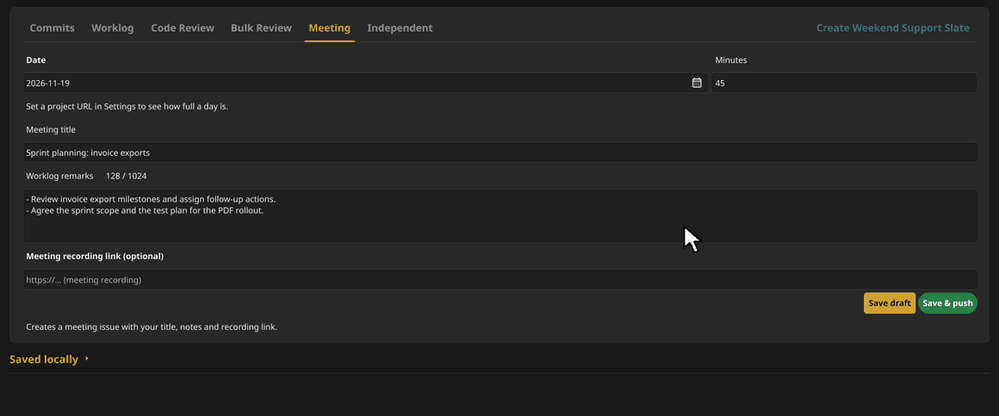

For **Meeting**, edit the title and notes freely. The optional recording link
is appended to the GitHub issue body as **Meeting Recording Link**. Leaving it
blank shows a maroon **Missing Meeting Recording** badge on saved entry cards;
saving and pushing remain available. The optional recording field sits below
the worklog remarks. Older daily meeting entries
keep their original issue when edited or re-pushed. The local Sprint Calendar
MEETING placeholder is a plan, separate from a logged meeting.

Day headings in the worklog calendars open that date on **Status**. Hover a
purple `…m planned` caption for the planned blocks and remaining time; click it
to open **Sprint Calendar** on that week's dates. The planner's always-available
**MEETING** bubble reserves local time without creating a meeting worklog.

**Report** separates earned receivable, projected receivable and weekend support
bonus. It shows the payment breakdown, draft/support/plan contributions, and
full-cycle versus weekdays-only projections for the remaining period. Seven
qualifying weekend-support issues make one paid set at the rate in Settings;
incomplete sets carry across periods. Its CSV export covers the selected payroll
period. **Log List > Export week** prepares the separate weekly email summary.

### Logging a commit

Tapping a tile on **Log Work** opens the logging popup. Everything except the
time is filled in for you: the date the commits were made, the owner from
Settings, the issue the commits reference, and remarks written from the commit
messages. **Worklog mins is the only field you have to fill in** — then
**Save & push**.

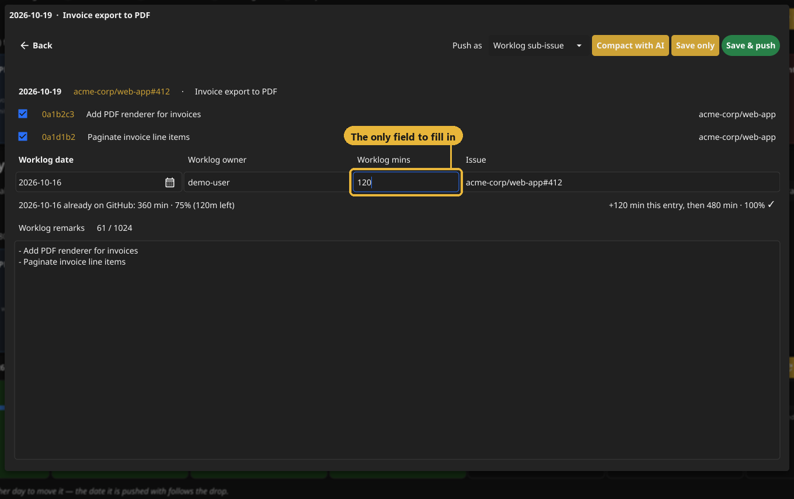

The line under the fields says how full the chosen day already is on GitHub and
what it comes to with this entry, then with anything planned for that day (in
purple), so you can see whether the day is finished before you push. To log against a different day, open the calendar on the date
field: every day carries its logged minutes and what it still owes, in the same
colours as the Status tab.

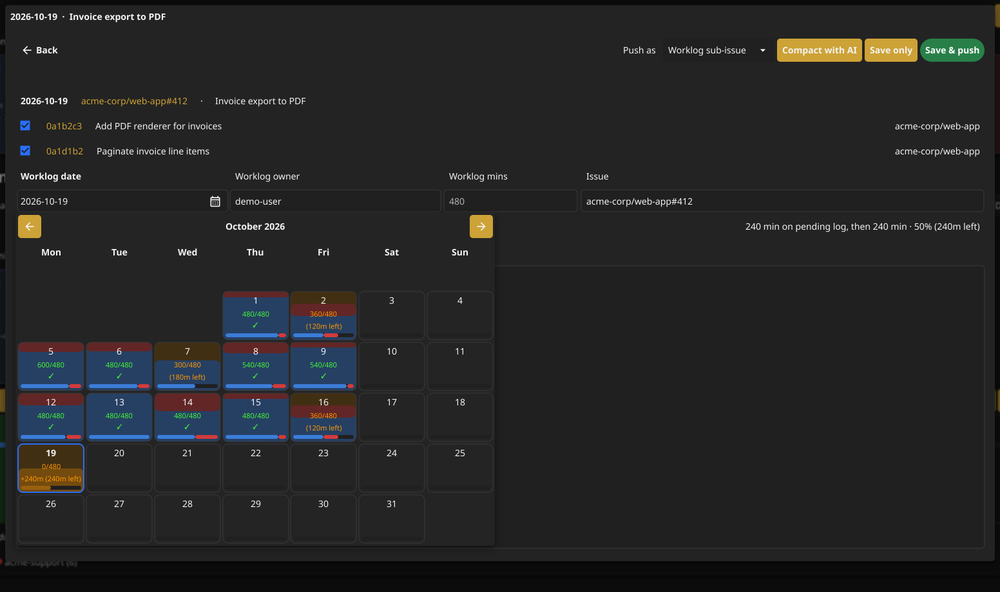

### Moving a draft to another day

Entries you save without pushing sit under **Saved locally, not pushed yet**,
and each one also stands on its day in the week calendar below. Each day shows
what is already on GitHub and what the drafts on it would bring it to. Time
planned for the day on the Sprint Calendar shows in purple beside its date
(`180m planned`) and counts in the waiting minutes and the day's score; a day
with nothing planned leaves it out. The date picker's month shows and counts it
the same way. If an
entry landed on the wrong day, drag the card onto the right one: the day under
the card lights up, turning green when the drop would finish it. Letting go
moves the entry, and that is the date it is pushed with.

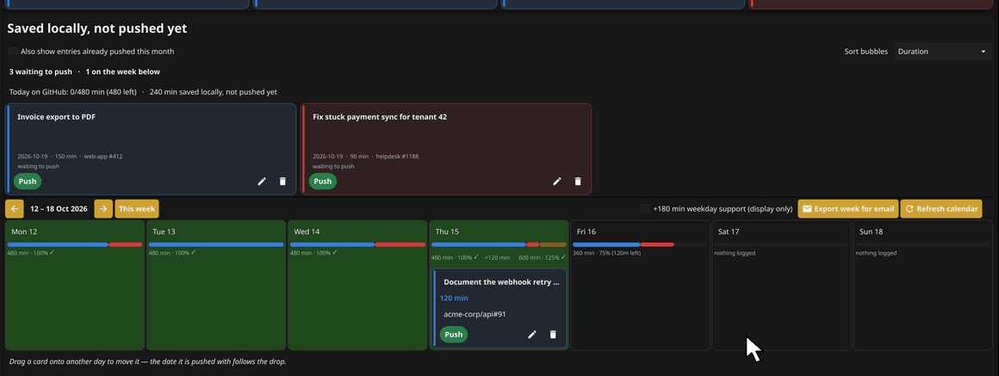

The screenshots and animations are rendered off screen from fictional data;
no GitHub access or real worklog is involved. To regenerate all README media
in PowerShell, keep the raw frames and intermediate images in system temp:

```powershell
$mediaTemp = Join-Path ([System.IO.Path]::GetTempPath()) ("worklog-readme-" + [guid]::NewGuid())
$env:DEMO_OUT = Join-Path $mediaTemp "screenshots"
$env:DEMO_FRAMES = Join-Path $mediaTemp "frames"
try {
    go test -tags 'ci,demo' -run '^TestReadme(Demo|PlannerDemo|ProjectsDemo)Frames$' -count=1 ./tests
    if ($LASTEXITCODE -ne 0) { throw "README renders failed" }
    python docs/make_readme_media.py $env:DEMO_OUT $env:DEMO_FRAMES docs
    if ($LASTEXITCODE -ne 0) { throw "README GIF generation failed" }
    Get-ChildItem -LiteralPath $env:DEMO_OUT -Filter *.png | Copy-Item -Destination docs/screenshots
} finally {
    Remove-Item Env:DEMO_OUT, Env:DEMO_FRAMES -ErrorAction SilentlyContinue
    if ($mediaTemp -and (Test-Path -LiteralPath $mediaTemp)) {
        $cleanupPath = (Resolve-Path -LiteralPath $mediaTemp).Path
        $tempRoot = [System.IO.Path]::GetFullPath([System.IO.Path]::GetTempPath())
        if (-not $cleanupPath.StartsWith($tempRoot, [StringComparison]::OrdinalIgnoreCase) -or
            (Split-Path $cleanupPath -Leaf) -notlike 'worklog-readme-*') {
            throw "Refusing to clean a path outside the README temp folder"
        }
        Remove-Item -LiteralPath $cleanupPath -Recurse -Force
    }
}
```

For a targeted refresh, run only `TestReadmeProjectsDemoFrames` and pass
`--only projects project-gantt` to the Python command. The planner test produces
`kanban`, `planner` and `support`; the original demo test produces `popup` and
`drag`. Copy only the generated final PNGs when updating selected media.

## Requirements

- **Go 1.26** or newer
- **A C toolchain.** Fyne uses cgo, so a working `gcc` has to be on `PATH`.
  On Windows, [MSYS2/MinGW-w64](https://www.msys2.org) or
  [WinLibs](https://winlibs.com) — installed to a path with **no spaces in it**.
  A gcc under `C:\Users\Your Name\...` passes an unquoted path to the linker and
  every cgo build dies with `ld.exe: cannot find C:/Users/Your`.
- **`gh`**, authenticated. Two commands, not one:

  ```
  gh auth login
  gh auth refresh -s project
  ```

  The token needs `repo`, `read:org` and `project`. `gh auth login` grants the
  first two but **not** `project` — that is the scope the board is read and
  written through, so without the refresh the Log work tab still finds commits
  and every push then fails. Confirm with `gh auth status`; all three scopes
  should be listed.

## Build and run

```
git clone <this repo> worklog-go
cd worklog-go
bash build.sh        # macOS or Linux; writes ../Worklog
../Worklog
```

On Windows, use the PowerShell script (and optionally run the offline tests):

```
.\build.ps1 -Test -Output ..\Worklog.exe
```

Both run `tools/patchfyne`. On Windows the build also hides the console window.
It applies the application's hand-cursor policy
to Fyne buttons, checkboxes, radio options, dropdowns, popup menu items and tabs.
It also gives standard gold buttons contrasting dark labels and icons, rounds
the corners of the button press flash, and gives buttons a **0.6-second** shrink-and-return
press animation (including icon buttons, menu pills and dialog actions). Custom
action tags and subtab choices use the same feedback; click areas and layout
stay fixed, and reduced-motion settings skip it. Dismiss actions, including the
**Pushed** popup's **OK**, finish their visible press feedback in the closing
layer even though the real popup closes immediately. It also changes the mouse wheel: it scrolls
the innermost scroller under the pointer that can still move (so a text field
or a list at its end no longer blocks the page), and glides instead of jumping.
The wheel code lives in `_fynepatch`, which the tool copies into the Fyne copy;
the go tool skips folders starting with `_`, so it builds nowhere else.
On a Mac the wheel keeps Fyne's own speed, since a trackpad already sends a stream
of small movements.
The tool builds a private copy of the pinned Fyne version under `.build`;
it does not modify the shared module cache or the project's dependencies.
A plain `go build` uses Fyne's default cursors, button colours and wheel, and on
any page where the pointer is over a fold, the wheel does nothing.

### On a Mac

Every release carries a `Worklog-macos` file, for both Apple and Intel Macs, added
by `.github/workflows/macos.yml` a few minutes after the release is published. To
get it:

```
gh release download --repo EldenZheng/EZ-Worklog-BLG --pattern Worklog-macos
chmod +x Worklog-macos
./Worklog-macos
```

Download it with `gh`: a browser marks the file as quarantined and macOS refuses
to open it, since it is not signed with a paid Apple certificate. If that has
happened, `xattr -d com.apple.quarantine Worklog-macos` clears it. Your data goes
in a `data` folder beside the file, and updates inside the app work as on Windows.
To try a branch before a release, run the workflow by hand from the Actions tab;
the file is left on the run as an artifact. Given a release's tag, the same run
builds that tag and attaches the file to the release, for one whose own run failed.

### Versions and updates

`build.ps1` stamps the exe with its version: `git describe` output for an
ordinary build (for example `v1.4.0-3-gabc1234-dirty`), shown at the foot of the
Settings sidebar. To ship a build to everyone:

```
.\build.ps1 -Release v1.4.1
```

This refuses uncommitted or unpushed work and an existing tag, runs the tests,
and publishes `Worklog.exe` as a GitHub release; the Mac build follows by itself.
On start-up every copy of the
app asks GitHub (through `gh`) for the latest release. When it is newer, a gold
**Update Available** capsule opens by the Settings gear and the sidebar offers
**Update to v1.4.1**,
which downloads the build for that platform, swaps it in and restarts. Nothing
in `data` is touched. **Check for updates** asks again on demand.

`-Release` needs `gh` signed in to the repo owner's account. Without it,
release by hand, in this order:

```
git tag v1.4.1
git push origin v1.4.1
git describe --tags --always --dirty   # must print exactly v1.4.1
.\build.ps1
```

then on GitHub draft a release from the tag and attach `..\Worklog.exe` (named
`Worklog.exe`). Tag before building: an exe built before the tag exists
locally, or with uncommitted changes, is stamped with the old version plus
`-dirty`, and every copy keeps offering the update. Run the tests first; this
path skips them.

> **Use `go build`, not `go run .`** — the app keeps its data in a `data`
> folder beside the binary, and `go run` builds into a temporary directory that is
> deleted afterwards, so everything you log is thrown away on exit. If you want
> `go run` for development, set `WORKLOG_DIR` first (see below).

### Where the data goes

In order of preference:

1. `$WORKLOG_DIR`, if it is set
2. a `data` folder beside the executable (created on first run)
3. the executable's own folder, for installs from before the `data` folder
   that still keep `worklog.csv` or `config.json` there

Report exports go to an `exports` folder inside it, and a crash leaves
`crash.log` there. Local data files are created as needed; they are ignored by
Git and do not belong in a commit:

| File | Contents |
| --- | --- |
| `config.json` | identity, source boards, display/report preferences and an optional history-backup location |
| `worklog.csv` | local drafts and pushed entries, remarks, meeting titles/recording links and commit logged markers |
| `ignored.json` | the commit shas you have deliberately kept off the pending list, and (as `!sha`) chore commits you brought back |
| `ignored-dates.json` | when each of those commits was ignored, for Settings > Clean up after |
| `sprint-planner.json` | local blocks, estimates, notes, calendar mode, filters and ordering |
| `support-weeks.json` | the weeks selected for the weekday-support preview |
| `projects.json` | named projects, parent scope, tab order and weekly status snapshots |

The historical GitHub backup is stored separately by default in the operating
system's user-config folder under `EZ-Worklog/history/` (on Windows,
`%AppData%/EZ-Worklog/history/`). Each owner/board combination uses a compressed
`worklogs-<key>.json.gz` file. **Settings > History backup > … > Reallocate
backup** changes its folder; the chosen path is saved in `config.json`.
This archive is not a backup of the other local files above.

Company repositories, board views, salary and support payments belong in local
Settings, never in source code. `config.json` is ignored by Git but is plain text,
not encrypted storage. GitHub Actions secrets are not used by this desktop app.
Do not commit the config or include it in release archives. Removing a value in
a new commit does not remove it from older commits.

When upgrading from a version with fixed meeting/review repositories, board
views or support payments, enter those values in Settings before using the
corresponding features. New installations leave these settings empty and assume
no salary or support payment.

## First run

The app starts empty and asks for nothing at launch — open **Settings** and
fill it in. Local files stay on your computer in the data directory and
optional history-backup folder above; there is no separate Worklog account
or hosted Worklog server. GitHub remains the source for pushed records.

| Field | Notes |
| --- | --- |
| GitHub username | Optional. Blank means whoever `gh` is logged in as. |
| Name on meeting issues | Optional display-name override, also used to recognise your weekly-support rota. Blank derives a name from Worklog owner. |
| Worklog owner | The value written to the board's *worklog-owner* field, and what Status and Report filter on. |
| Repos or orgs to scan | Comma-separated. A bare `myorg` scans every repo in the org; `myorg/one-repo` scans just that one. |
| Worklog project URLs | One per line, e.g. `https://github.com/orgs/myorg/projects/9`. Status and Report read all of them. |
| Board view URLs | Optional saved views for weekly links, one per line. Preserves view parameters; blank uses the configured project URLs. |
| Meeting / Bulk review repository | Separate `owner/repo` destinations for meeting issues and daily bulk review issues. Required before pushing those kinds. |
| Base salary per 21 days | Drives the Report tab's rate. A period pays for 21 working days regardless of what the calendar says. |
| Support payment per set | Payment in the salary currency per seven qualifying issues. Blank means unset; incomplete sets still carry across periods. |
| Currency / Display in | Search dropdowns of the codes `open.er-api.com` has rates for. Display in is converted with a rate fetched from it, at most once a day; untick it to hide the conversion. |
| Look back (days) | How far back the pending-commit scan goes. |
| Push minutes to | Which issue field a push writes the entry's minutes to: **Worklog Reported(mins)** (default), **Worklog Approved(mins)**, or both. A retry or re-push uses the choice set at that time. |
| AI for titles | The AI command-line assistant (Claude Code, Codex or Gemini CLI, whichever are installed) that **Suggest** asks for a Worklog title from the remarks. It runs on that CLI's own sign-in; Claude Code on a subscription uses your plan, not API credit. **None** hides Suggest. |
| Repo folders | Folders containing your local clones. Clone discovery and local Git log scans share at most two workers, or one on machines with one or two logical CPUs, to reduce startup contention. |
| Clean up after (days) | Forgets ignored commits and commit details on pushed entries after this many days (or the lookback, if longer). The worklog entries stay. Blank keeps everything. |
| Finished report range (months) | Months per page in Projects' Finished report; clicking its month label opens all weeks. |
| History backup | Back up the legacy worklog range, inspect storage, or use **…** to move/clear the archive. No push-mode or Anthropic-key setting is needed. |

### What the board needs

The project the issues sit on must carry worklog fields. The app matches
`worklog` plus `date`, `owner`, `min` and `remark`, case-insensitively, and
supports names prefixed with `ZZZ (DEPRECATED)`. Populated current fields take
precedence for reads. Project field writes use project-field IDs; the mirrored
**Worklog Reported(mins)** field uses its underlying issue-field ID and the
issue-field API. The app also finds it directly on the organisation when the
board does not display that column. Status, Report and Log List read the same
issue field for SOP worklogs. The former **Actual Worklog (mins)** name remains
supported; the reported field takes precedence when both are present.
A `Status` field with a `Done` option is required for a
completed push; the app verifies the board item is Done before marking the
local entry pushed.
Without those fields an entry still pushes, and the app says which ones it could
not write.

## Code layout

Follow the [UI styling guide](docs/STYLING.md) for panels, floating bubbles,
overflow, headings, buttons and motion.

Each menu has its own package; anything two menus share lives under `shared`.

| Folder | What is in it |
| --- | --- |
| `main.go` | starts the app |
| `internal/assemble` | builds the tabs and connects the menus to the shared code |
| `internal/menus/logwork` | Log Work: pending commits, the week strip, entry editors |
| `internal/menus/loglist` | Log List |
| `internal/menus/commitlist` | Commit List |
| `internal/menus/meeting` | Meeting update |
| `internal/menus/status` | Status calendar and day panel |
| `internal/menus/report` | Report, its chart and CSV export |
| `internal/menus/settings` | Settings |
| `internal/menus/kanban` | Kanban board |
| `internal/menus/sprintcalendar` | Sprint Calendar and plan upkeep |
| `internal/menus/projects` | Projects: saved projects, child-issue fetch, figures and charts |
| `internal/shared/shell` | the window state (`UI`), tabs, loading, and components used by several menus (commit calendar, week columns, colours, popups) |
| `internal/shared/widgets` | small Fyne widgets with no app state |
| `internal/shared/backend` | storage, GitHub, sprint planning model, exports |
| `tests` | the test suite |

Buttons take their look from the roles in `internal/shared/shell/buttons.go`,
chosen by what the button does: green pill for anything that writes to GitHub
(`GitHubButton`, `CompactGitHubButton`), red pill for removals
(`DestructiveButton`, `RemovalButtons`), plain gold for local actions and reads,
and no fill for icon buttons (`QuietButton`). Menus never set a button's
Importance colour or use Fyne's stock confirm dialogs, and
`tests/button_roles_test.go` enforces both.

Shared code never imports a menu. Where it has to call one (redrawing Log
Work after a push, say) it goes through `shell.Hooks`, which
`assemble.WireHooks` fills in at start-up.

## Tests

```
go test ./...
```

The tests live in `tests/` and drive the app through its packages. They are
offline by default — ordinary tests do not reach GitHub. Use the prepared
Fyne module for checks that exercise patched controls:

```
go test -modfile .build/cursors/worklog.mod -tags cursors ./...
```

Run `build.ps1` (Windows) or `build.sh` (macOS) first to prepare that module.
On Windows, if `gcc` is not the first one on `PATH`, point cgo
at the right one:

```
CC=C:/mingw64/bin/gcc.exe go test ./...
```

`tests/live_probes_test.go` is the exception, and is behind a build tag for that
reason: it calls real GitHub with whichever org, project and issue were being
worked on at the time. Edit the refs to something on your own account before
running it.

```
go test -tags live -run Probe -v ./tests
```

`ld.exe: .rsrc merge failure: multiple non-default manifests` during a Windows
build is harmless — the binary is still produced. It comes from the embedded
icon resource in `rsrc_windows_*.syso`.

### Regenerating README GIFs

The demo-tagged tests render real widgets off-screen with fictional data. They
never launch the app executable or call live GitHub. Keep intermediate captures
in the system temp folder and remove them after producing the GIFs. For the
Settings and Meeting walkthroughs, after preparing the build module:

```powershell
$demo = Join-Path $env:TEMP ('worklog-readme-' + [guid]::NewGuid())
$previousFrames = $env:DEMO_FRAMES
try {
    $env:DEMO_FRAMES = Join-Path $demo 'frames'
    go test -modfile .build/cursors/worklog.mod -tags cursors,demo ./tests -run '^TestReadmeSettingsMeetingDemoFrames$' -count=1
    if ($LASTEXITCODE -ne 0) { throw 'README capture failed' }
    python docs/make_readme_media.py docs/screenshots $env:DEMO_FRAMES docs --only settings-storage meeting-worklog
    if ($LASTEXITCODE -ne 0) { throw 'GIF generation failed' }
} finally {
    $env:DEMO_FRAMES = $previousFrames
    if (Test-Path -LiteralPath $demo) { Remove-Item -LiteralPath $demo -Recurse -Force }
}
```

The Python finishing script requires Pillow. The other `TestReadme*DemoFrames`
recordings also accept `DEMO_OUT` for still images; pass a temp folder there too,
then copy only the finished documentation assets into `docs/`.

#### v2.0.0 issue media

Three captioned GIFs demonstrate the new features with fictional data:
[Worklog and commit references](docs/v2-worklog-flow.gif),
[the pull request offer](docs/v2-pull-request.gif), and
[the Log Work calendar](docs/v2-logwork-calendar.gif).
The [Repo folders screenshot](docs/screenshots/v2-repo-folders.png) shows the
required setup under Settings > Sources.

The demo executes the Worklog push against mocked GitHub responses and rewrites
commits in a temporary clone whose remote is a temporary bare repository. It
checks the Worklog's parent, type and minutes, the added commit references,
preserved uncommitted edits, and the PR link. It never contacts GitHub or uses
the app's real data. Captions are added outside the app capture.

After preparing the build module, regenerate all four assets with:

```powershell
$v2Media = Join-Path $env:TEMP ('worklog-v2-media-' + [guid]::NewGuid())
$previousFrames, $previousOut = $env:DEMO_FRAMES, $env:DEMO_OUT
try {
    $env:DEMO_FRAMES = Join-Path $v2Media 'frames'
    $env:DEMO_OUT = Join-Path $v2Media 'screenshots'
    go test -modfile .build/cursors/worklog.mod -tags cursors,demo ./tests -run '^TestReadmeV2DemoFrames$' -count=1
    if ($LASTEXITCODE -ne 0) { throw 'v2 media capture failed' }
    python docs/make_readme_media.py $env:DEMO_OUT $env:DEMO_FRAMES docs --only v2-worklog-flow v2-pull-request v2-logwork-calendar
    if ($LASTEXITCODE -ne 0) { throw 'v2 media generation failed' }
} finally {
    $env:DEMO_FRAMES, $env:DEMO_OUT = $previousFrames, $previousOut
    if (Test-Path -LiteralPath $v2Media) { Remove-Item -LiteralPath $v2Media -Recurse -Force }
}
```

On Windows, use a C compiler installed at a path without spaces if the linker
cannot resolve `default-manifest.o`; set `CC` for that shell session. This
machine's alternate compiler is `C:\mingw64\bin\gcc.exe`.
