# Worklog

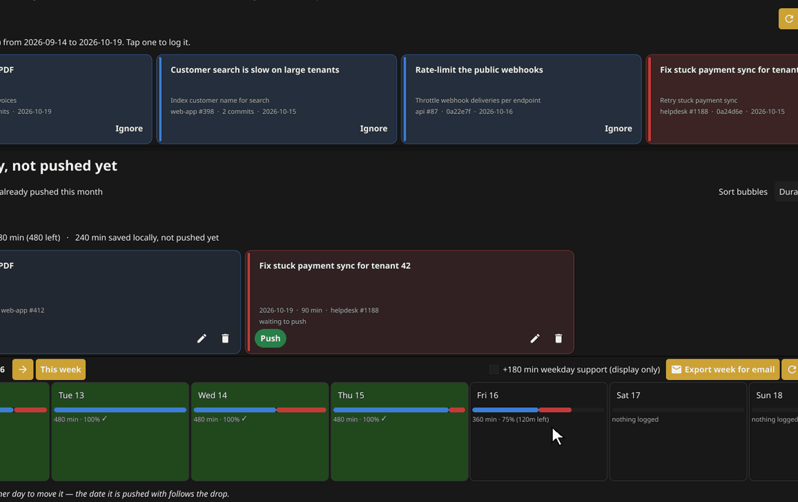

*Tap an unlogged commit, pick the day from the calendar — each day shows how
full it already is and what it still owes — and type the minutes. That is the
whole entry.*

A desktop app for logging work against GitHub issues and reading the result
back off a GitHub Project board.

It scans the commits you have pushed but not yet logged, turns each one into a
worklog entry, and pushes that entry to the project board as a sub-issue with
the date, minutes, owner and remarks filled in. The Status and Report tabs then
read those entries back from the board — a calendar of the month, and a payroll
period totalled against a daily target.

Built with [Fyne](https://fyne.io). All GitHub access goes through the
[`gh` CLI](https://cli.github.com), so the app never handles a token itself.

## Tabs

| Tab | What it does |
| --- | --- |
| **Log work** | Commits plus manual entries. Every issue or PR field takes `owner/repo#123`, `owner/repo/issues/123` (or `/pull/123`) and the full GitHub link alike. **Code Review** takes one PR, resolves its `Refs` issue and files the worklog there (a direct issue also works); when the PR names several issues, a dropdown beside the link lets you pick one. **Bulk Review** is a growing two-column PR/minutes sheet and creates one daily `<Name> Code Review: <date>` issue. |
| **Status** | A month calendar; each day fills towards the daily target, coloured by organisation. |
| **Report** | A payroll period — the 21st to the 20th — as stat tiles, a per-day bar chart, and the split by organisation. |
| **Settings** | Everything below. |
| **Kanban** | Issues and pull requests from your configured projects, with sprint dates and estimates. Filter by project or type; drag cards between statuses or onto a sprint to update GitHub. |
| **Sprint Calendar** | A local week/month/sprint calendar using Status styling, editable durations and drag-and-drop planning across multiple days. |

Tapping an organisation in any colour key hides its work across all three tabs.

### Kanban and local sprint planning

The **Kanban** and **Sprint Calendar** menus are grouped on the right side of
the menu bar. Both reuse the organization colors and striped bubbles from
Log Work, including custom colors from Settings.

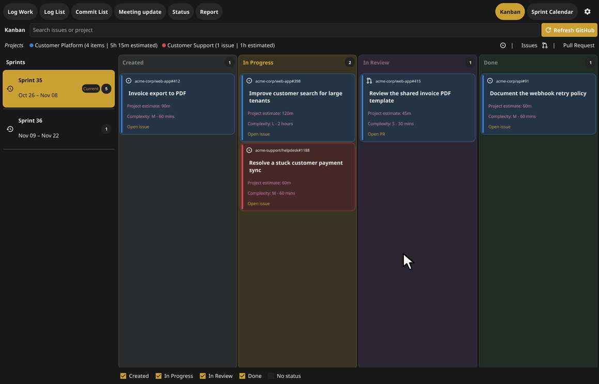

*The icon-and-text filters on the right of Projects toggle Issues and Pull
Request independently. Your type and column choices are remembered locally.*

**Kanban** reads the project URLs and per-board filters under Settings > Sources
> Kanban boards and filters. Existing installations start from their worklog
project URLs with `assignee:@me is:open`; shared GitHub views are never read.
Add/remove boards and edit each filter independently. A blank filter reads all
items in the project. Removing all sources disables board fetching.
It opens on the current sprint; click a sprint in the sidebar to select it and
click it again to show all items. No Sprint is a compact row. Thick rows combine matching sprint
dates across projects, hide zero counts and group older sprints under Completed.
The project legend in either menu combines item counts and estimated time
with the project toggle. Selected sprints have a gold fill; the Current badge
keeps its gold outline. No Sprint uses gold text and a gold fill when selected.
Unselected sprint rows blend into the page, with visible grey dividers between
them. On Kanban, the icon-and-text type filters share the Projects row on the
right; click either to hide or show that type. Both types start enabled. Choices
are saved as `KanbanTypes` in `sprint-planner.json`, including hiding both.
A column, and the Sprint Calendar's Sprint Issues list, shows each project's
first card, then each project's second, and so on. Drag a chip along either
menu's legend to choose which project comes first in each position; both menus
share the order, saved as `ProjectOrder`. Every project starts shown; switching
one off in a legend lasts until the app closes.
Refresh GitHub sits
on the right with its icon. The default columns are Created (grey), Analysis
(dark blue), In Progress (yellow), Pending Customer Feedback (dark purple),
Pending Test (orange), Server Update Required (pink), In Review (purple), and
Done (green). The gold checkboxes beneath the board include every status,
including the ones currently displayed. These choices are saved in
`sprint-planner.json` as `KanbanColumns`, including an empty selection. Their controls sit beneath the
board rather than the sprint sidebar. Status colors appear in softly tinted
column backgrounds, quieter full-column outlines and header
text. Kanban cards retain their original project-colored fill and stripe,
show a gold issue or pull request icon beside a small `owner/repo#number`,
which links to the issue or pull request, then the complete title. Estimate and
complexity appear on separate pink lines. When no sprint is selected the
card's sprint sits at the bottom as a gold tag.

Changes made on the board are saved to GitHub one at a time, in the order you
make them, so you can keep dragging while earlier saves run. A card waiting its
turn is drawn where it is going, marked **Queued**. Moving it again before it
is sent replaces the queued change, and moving it back cancels it. If GitHub
refuses a change, only that card goes back and the rest still save. Refresh
GitHub waits until the queue is empty. Closing the app with changes still
queued asks first, and a GitHub call that does not answer within three minutes
fails rather than holding up the queue. The status palette
itself is unchanged. The old elapsed-days progress
bars were removed; they did not measure completed work.
Columns expand to fill the space beside the fixed sprint sidebar; many columns
retain horizontal scrolling at a readable minimum width.
Drop a card onto a status or sprint to update that field in its source project.
Clicking a card also provides status and sprint selectors. Direct links open
GitHub without opening the editor first.
The editor places GitHub fields and local planning controls in two columns
without an outer scrolling page.

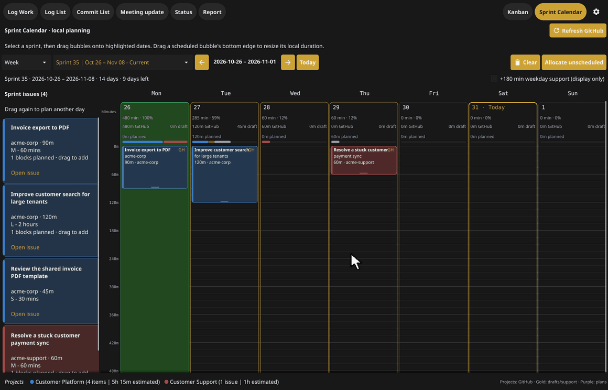

*Plan the same issue on several days and resize each bubble by its bottom edge.
Purple shows remaining planned time, gold shows local drafts or temporary
support, and project colors show time already logged on GitHub.*

**Sprint Calendar** has a sprint dropdown for current, future and completed
sprints alongside **Week**, **Sprint** and **Month** view modes. Sprint choices
show the title and dates, with gold text for the current sprint. Both calendar
dropdowns use gold filled rows for their selected options. The selected sprint
is centered when opening its dropdown, including the first and last choices. Checkboxes, dropdown
opening/hover feedback animate. Today has a gold
outline and `- Today` label. Sprint view
shows the selected sprint's full date range. Selecting a sprint moves the
calendar to its dates. Both selections are saved locally; the view is written
to `CalendarMode` in `sprint-planner.json` and restored when the app starts. Every bubble is
retained in month view; rows grow to fit their issues, share unused viewport
height and scroll when needed. Week view expands the minute scale and bubbles
together to fill spare height; month rows keep their compact scale. Month wheel
and trackpad scrolling moves six times faster. Every date shows its minutes,
percentage, and a progress bar at the top. This reads actual GitHub worklogs
from the same configured sources, owner filter, and monthly cache as Log Work.
Opening the calendar loads every month in the displayed range; Refresh GitHub
refreshes both the issue boards and worklogs. Saved unpushed Log Work rows are
included as drafts. Project colors mean GitHub minutes, gold means drafts or
temporary support, and purple means remaining planned minutes. Logged/draft
time for the same issue and date reduces its plan contribution to prevent double
counting. A local completion checkbox never fabricates GitHub time. Dates label
all three readings. Full logged days have a stronger green background; days
that reach the target through drafts or plans use Log Work's lighter green.
The shared ruler on the left measures planned minutes per day, starting at 0m,
with labels every 60m and grid marks every 15m. Bubbles stack in appointment
order and their heights represent their durations, without clock-time gaps.
Drag the bottom edge inside a scheduled bubble to stretch it in 15-minute steps.
There is no separate resize panel. Resizing preserves the saved start time,
rejects overlaps, and keeps the calendar's scroll position. Manual duration
entry also requires 15-minute increments. Planned dates use gold outlines,
turning green at the daily target.
Hover over an issue in the left sidebar to preview eligible dates. Scheduled
bubbles highlight dates only while held for moving; resizing shows no drop
highlights. During a drag, only dates inside its sprint with
enough free time light up in translucent light blue, with a gold outline on the
hovered date. Every active sprint issue stays in the left sidebar after scheduling;
drag it again to add a block on another day. Drop a tray bubble to create a
new time block, or drag a scheduled bubble
to move that block while preserving its duration. The month scrolls when a
carried bubble reaches the top or bottom edge.
**Clear** confirms before removing local blocks from the selected sprint's
visible projects. It keeps local estimates, notes, other sprints and GitHub data.
Both Clear confirmations and Log Work Delete use compact modals with buttons
anchored at the bottom: red pill-shaped removal actions and gold rounded Cancel.
Hover over a planned day to reveal its Clear icon immediately, without clicking;
the day header is repainted when the icon appears or disappears. It clears only that date
after confirmation. Sprint selection and redraws preserve the Kanban sidebar,
calendar, and sprint-issue sidebar scroll positions. Calendar modes remember
their own positions when switching between Week, Sprint, and Month.

The gold **+180 min weekday support (display only)** checkbox works like Log
Work's calendar: it adds a yellow support segment to projected daily totals and
progress bars, skips weekends, and avoids duplicating a weekly support issue
already planned on that date. It creates no time blocks and does not save or
push support minutes. It resets when navigating to another period or sprint.

Click a bubble to edit local effort, complexity, notes, completion and time
blocks. Duration defaults to the project's Estimated Effort (Mins), then its
complexity scale (10/30/60/120/240/480 minutes), or 60 minutes when neither is
set. New time blocks round up to the next 15 minutes; the source estimate stays
unchanged. Existing saved durations are retained until edited. Local durations
can exceed the GitHub estimate without changing GitHub.
**Allocate unscheduled** fills weekday 09:00-17:00 slots, preserves existing
appointments and splits long tasks across days. Issues that cannot fit before
the sprint ends remain unscheduled. Manual blocks must fall inside the issue's
assigned sprint and cannot overlap other appointments.

The local schedule, overrides, display mode and last successful board snapshot
are stored in `sprint-planner.json` beside the app's other data. Calendar
changes never become GitHub worklogs or project fields. Only Kanban drags and
its explicit **Apply status/sprint** controls change GitHub.

Board configuration is stored in `config.json` as a `kanban_boards` array of
objects with `url` and `filter` text fields.

The Log Work pending-commit search matches issue titles, references and commit
text. The same query filters saved entries and the Log Work calendar.

In Settings, the identity panel stays fixed while only the right-hand form
scrolls. Use the three-dot control on an organization color chip to open the
color picker, including its advanced custom-color controls. Colors apply across
the app and are saved in `org_colors`. Successful saves show a small bottom-left
toast without blocking the form.

<table>
  <tr>
    <td>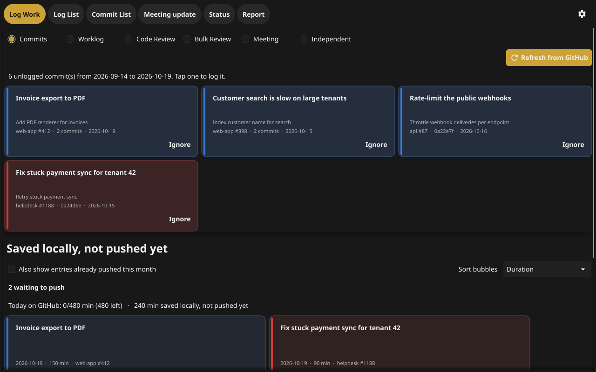</td>
    <td>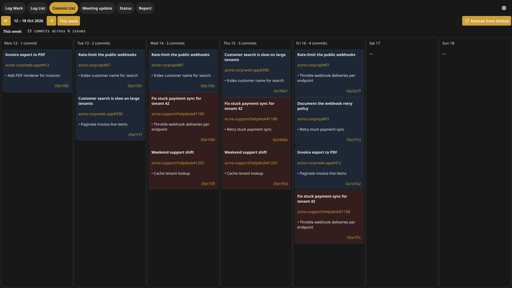</td>
  </tr>
  <tr>
    <td align="center"><b>Log Work</b> — unlogged commits, one tap to log</td>
    <td align="center"><b>Commit List</b> — the week by day and issue</td>
  </tr>
  <tr>
    <td>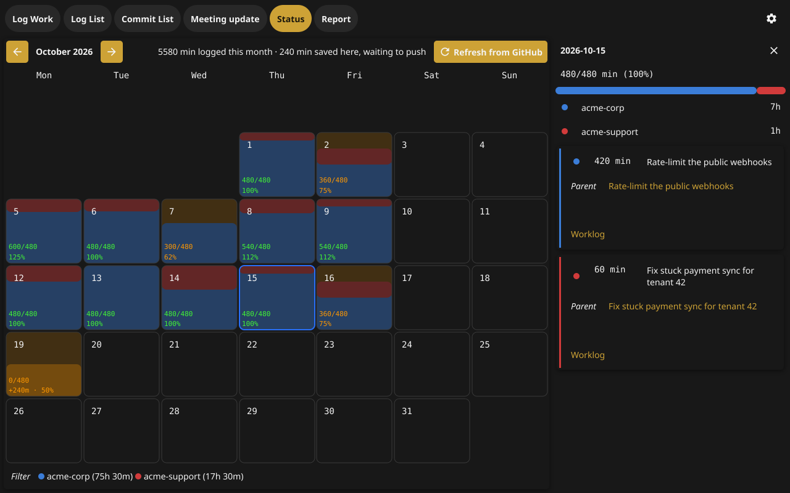</td>
    <td>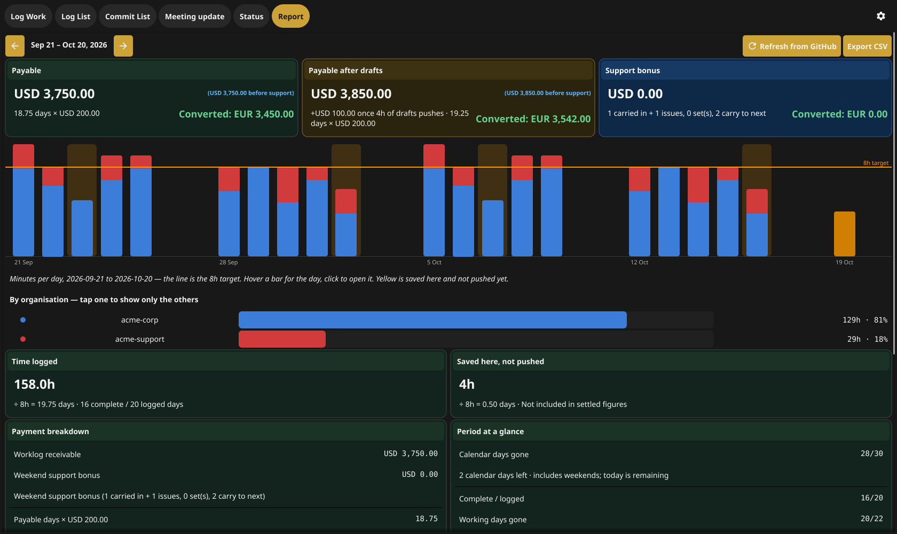</td>
  </tr>
  <tr>
    <td align="center"><b>Status</b> — the month against the daily target</td>
    <td align="center"><b>Report</b> — the payroll period, totalled</td>
  </tr>
  <tr>
    <td>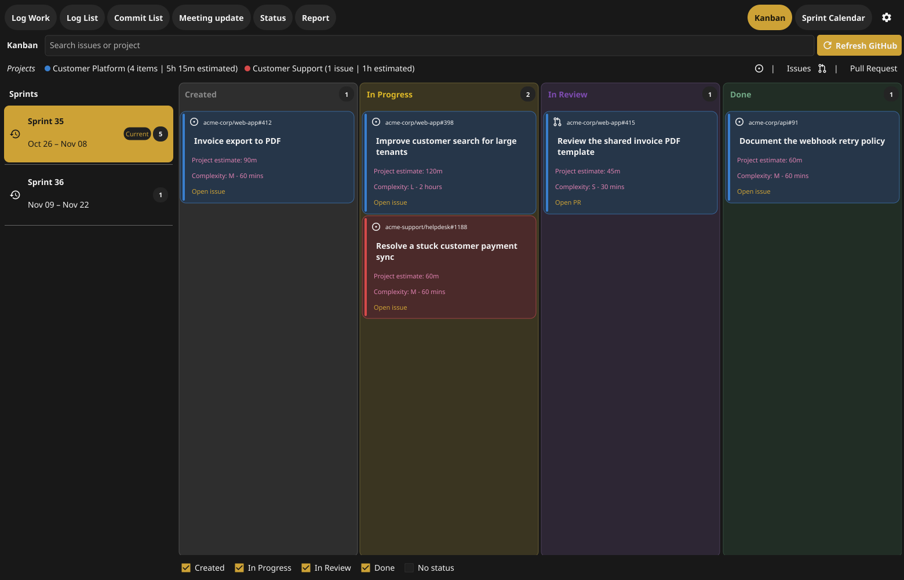</td>
    <td>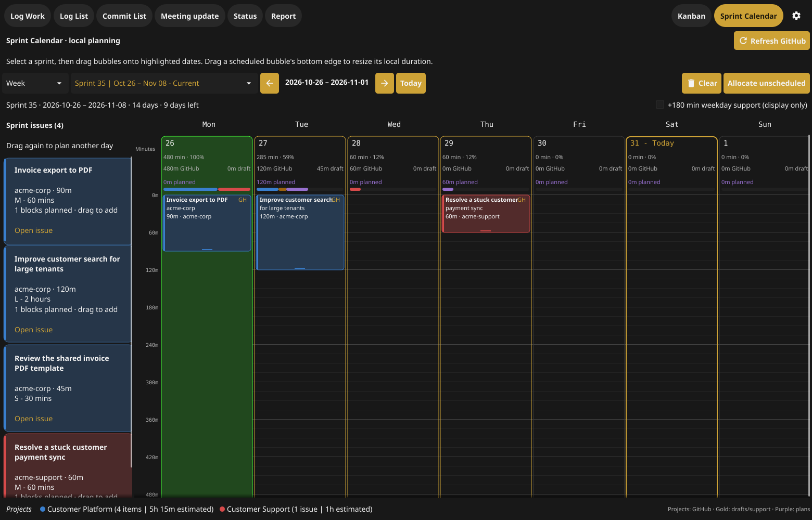</td>
  </tr>
  <tr>
    <td align="center"><b>Kanban</b> — issues and pull requests across projects</td>
    <td align="center"><b>Sprint Calendar</b> — plan locally in 15-minute steps</td>
  </tr>
</table>

### Logging a commit

Tapping a tile on **Log Work** opens the logging popup. Everything except the
time is filled in for you: the date the commits were made, the owner from
Settings, the issue the commits reference, and remarks written from the commit
messages. **Worklog mins is the only field you have to fill in** — then
**Save & push**.

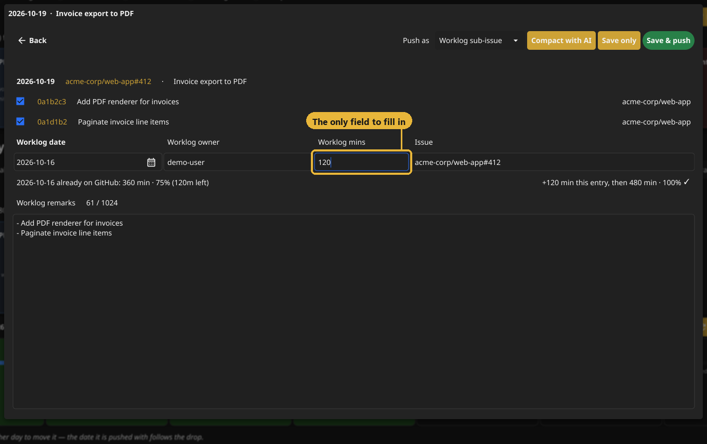

The line under the fields says how full the chosen day already is on GitHub and
what it comes to with this entry, so you can see whether the day is finished
before you push. To log against a different day, open the calendar on the date
field: every day carries its logged minutes and what it still owes, in the same
colours as the Status tab.

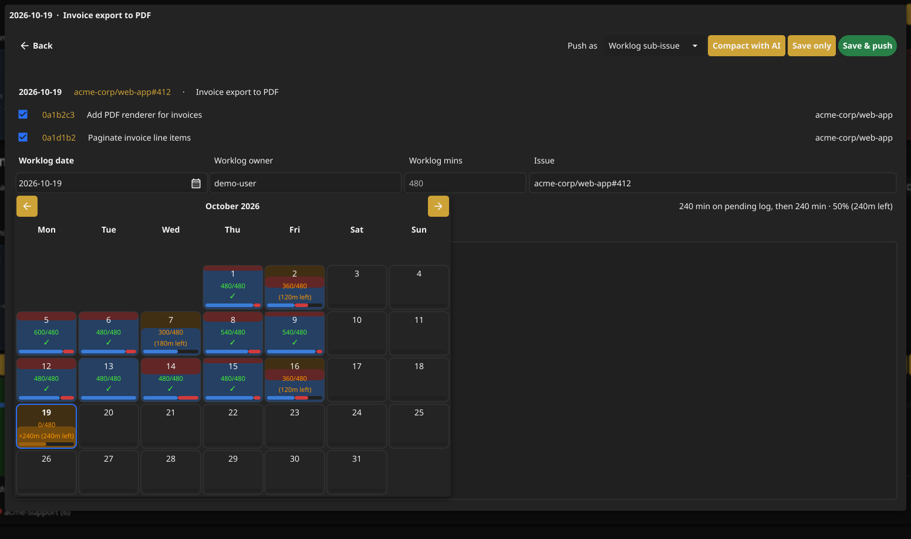

### Moving a draft to another day

Entries you save without pushing sit under **Saved locally, not pushed yet**,
and each one also stands on its day in the week calendar below. Each day shows
what is already on GitHub and what the drafts on it would bring it to. If an
entry landed on the wrong day, drag the card onto the right one: the day under
the card lights up, turning green when the drop would finish it. Letting go
moves the entry, and that is the date it is pushed with.

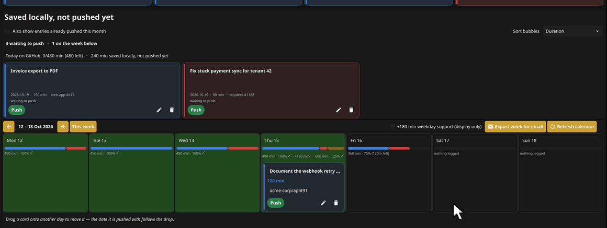

The screenshots and the animations are rendered off screen from made-up data —
no GitHub access, no real worklog. To regenerate them after a UI change:

```
DEMO_OUT=$PWD/docs/screenshots DEMO_FRAMES=/tmp/worklog-frames go test -tags 'ci,demo' -run '^TestReadme(Demo|PlannerDemo)Frames$' ./tests
python docs/make_readme_media.py docs/screenshots /tmp/worklog-frames docs
```

To regenerate just the Kanban and Sprint Calendar media in PowerShell:

```powershell
$env:DEMO_OUT = "$PWD/docs/screenshots"
$env:DEMO_FRAMES = "$PWD/.build/readme-frames"
go test -tags 'ci,demo' -run '^TestReadmePlannerDemoFrames$' -count=1 ./tests
python docs/make_readme_media.py docs/screenshots .build/readme-frames docs --only kanban planner
```

The frame directory is temporary and can be removed after generating the GIFs.

## Requirements

- **Go 1.26** or newer
- **A C toolchain.** Fyne uses cgo, so a working `gcc` has to be on `PATH`.
  On Windows, [MSYS2/MinGW-w64](https://www.msys2.org) or
  [WinLibs](https://winlibs.com) — installed to a path with **no spaces in it**.
  A gcc under `C:\Users\Your Name\...` passes an unquoted path to the linker and
  every cgo build dies with `ld.exe: cannot find C:/Users/Your`.
- **`gh`**, authenticated. Two commands, not one:

  ```
  gh auth login
  gh auth refresh -s project
  ```

  The token needs `repo`, `read:org` and `project`. `gh auth login` grants the
  first two but **not** `project` — that is the scope the board is read and
  written through, so without the refresh the Log work tab still finds commits
  and every push then fails. Confirm with `gh auth status`; all three scopes
  should be listed.

## Build and run

```
git clone <this repo> worklog-go
cd worklog-go
bash build.sh        # macOS or Linux; writes ../Worklog
../Worklog
```

On Windows, use the PowerShell script (and optionally run the offline tests):

```
.\build.ps1 -Test -Output ..\Worklog.exe
```

Both run `tools/patchfyne`. On Windows the build also hides the console window.
It applies the application's hand-cursor policy
to Fyne buttons, checkboxes, radio options, dropdowns, popup menu items and tabs.
It also gives standard gold buttons contrasting dark labels and icons, rounds
the corners of the button press flash, and changes the mouse wheel: it scrolls
the innermost scroller under the pointer that can still move (so a text field
or a list at its end no longer blocks the page), and glides instead of jumping.
The wheel code lives in `_fynepatch`, which the tool copies into the Fyne copy;
the go tool skips folders starting with `_`, so it builds nowhere else.
On a Mac the wheel keeps Fyne's own speed, since a trackpad already sends a stream
of small movements.
The tool builds a private copy of the pinned Fyne version under `.build`;
it does not modify the shared module cache or the project's dependencies.
A plain `go build` uses Fyne's default cursors, button colours and wheel, and on
any page where the pointer is over a fold, the wheel does nothing.

### On a Mac

Every release carries a `Worklog-macos` file, for both Apple and Intel Macs, added
by `.github/workflows/macos.yml` a few minutes after the release is published. To
get it:

```
gh release download --repo EldenZheng/EZ-Worklog-BLG --pattern Worklog-macos
chmod +x Worklog-macos
./Worklog-macos
```

Download it with `gh`: a browser marks the file as quarantined and macOS refuses
to open it, since it is not signed with a paid Apple certificate. If that has
happened, `xattr -d com.apple.quarantine Worklog-macos` clears it. Your data goes
in a `data` folder beside the file, and updates inside the app work as on Windows.
To try a branch before a release, run the workflow by hand from the Actions tab;
the file is left on the run as an artifact.

### Versions and updates

`build.ps1` stamps the exe with its version: `git describe` output for an
ordinary build (for example `v1.4.0-3-gabc1234-dirty`), shown at the foot of the
Settings sidebar. To ship a build to everyone:

```
.\build.ps1 -Release v1.4.1
```

This refuses uncommitted or unpushed work and an existing tag, runs the tests,
and publishes `Worklog.exe` as a GitHub release; the Mac build follows by itself.
On start-up every copy of the
app asks GitHub (through `gh`) for the latest release. When it is newer, a gold
**Update Available** capsule opens by the Settings gear and the sidebar offers
**Update to v1.4.1**,
which downloads the build for that platform, swaps it in and restarts. Nothing
in `data` is touched. **Check for updates** asks again on demand.

`-Release` needs `gh` signed in to the repo owner's account. Without it,
release by hand, in this order:

```
git tag v1.4.1
git push origin v1.4.1
git describe --tags --always --dirty   # must print exactly v1.4.1
.\build.ps1
```

then on GitHub draft a release from the tag and attach `..\Worklog.exe` (named
`Worklog.exe`). Tag before building: an exe built before the tag exists
locally, or with uncommitted changes, is stamped with the old version plus
`-dirty`, and every copy keeps offering the update. Run the tests first; this
path skips them.

> **Use `go build`, not `go run .`** — the app keeps its data in a `data`
> folder beside the binary, and `go run` builds into a temporary directory that is
> deleted afterwards, so everything you log is thrown away on exit. If you want
> `go run` for development, set `WORKLOG_DIR` first (see below).

### Where the data goes

In order of preference:

1. `$WORKLOG_DIR`, if it is set
2. a `data` folder beside the executable (created on first run)
3. the executable's own folder, for installs from before the `data` folder
   that still keep `worklog.csv` or `config.json` there

Report exports go to an `exports` folder inside it, and a crash leaves
`crash.log` there. Three files are created there on first use. All three are in `.gitignore` and
none of them belong in a commit:

| File | Contents |
| --- | --- |
| `config.json` | your settings — **including the Anthropic API key, if you set one** |
| `worklog.csv` | every entry you have logged, remarks and all |
| `ignored.json` | the commit shas you have deliberately kept off the pending list |
| `ignored-dates.json` | when each of those commits was ignored, for Settings > Clean up after |

Company repositories, board views, salary and support payments belong in local
Settings, never in source code. `config.json` is ignored by Git but is plain text,
not encrypted storage. GitHub Actions secrets are not used by this desktop app.
Do not commit the config or include it in release archives. Removing a value in
a new commit does not remove it from older commits.

When upgrading from a version with fixed meeting/review repositories, board
views or support payments, enter those values in Settings before using the
corresponding features. New installations leave these settings empty and assume
no salary or support payment.

## First run

The app starts empty and asks for nothing at launch — open **Settings** and
fill it in. Nothing is stored anywhere but the directory above; there is no
account and no server.

| Field | Notes |
| --- | --- |
| GitHub username | Optional. Blank means whoever `gh` is logged in as. |
| Worklog owner | The value written to the board's *worklog-owner* field, and what Status and Report filter on. |
| Repos or orgs to scan | Comma-separated. A bare `myorg` scans every repo in the org; `myorg/one-repo` scans just that one. |
| Worklog project URLs | One per line, e.g. `https://github.com/orgs/myorg/projects/9`. Status and Report read all of them. |
| Board view URLs | Optional saved views for weekly links, one per line. Preserves view parameters; blank uses the configured project URLs. |
| Meeting / Bulk review repository | Separate `owner/repo` destinations for daily meeting and bulk review issues. Required before pushing those kinds. |
| Base salary per 21 days | Drives the Report tab's rate. A period pays for 21 working days regardless of what the calendar says. |
| Support payment per set | Payment in the salary currency per seven qualifying issues. Blank means unset; incomplete sets still carry across periods. |
| Currency / Display in | Search dropdowns of the codes `open.er-api.com` has rates for. Display in is converted with a rate fetched from it, at most once a day; untick it to hide the conversion. |
| Look back (days) | How far back the pending-commit scan goes. |
| Default push mode | `subissue` creates a sub-issue under the referenced issue; `issue` writes the fields onto that issue directly. |
| Anthropic API key | Optional, only used by "Compact with AI" when remarks run past the board's 1024-character field limit. |

### What the board needs

The project the issues sit on must carry fields whose names start with
`Worklog` — the app matches on `worklog` + `date`, `owner`, `min` and `remark`,
case-insensitively. A `Status` field with a `Done` option is required for a
completed push; the app verifies the board item is Done before marking the
local entry pushed.
Without those fields an entry still pushes, and the app says which ones it could
not write.

## Code layout

Each menu has its own package; anything two menus share lives under `shared`.

| Folder | What is in it |
| --- | --- |
| `main.go` | starts the app |
| `internal/assemble` | builds the tabs and connects the menus to the shared code |
| `internal/menus/logwork` | Log Work: pending commits, the week strip, entry editors |
| `internal/menus/loglist` | Log List |
| `internal/menus/commitlist` | Commit List |
| `internal/menus/meeting` | Meeting update |
| `internal/menus/status` | Status calendar and day panel |
| `internal/menus/report` | Report, its chart and CSV export |
| `internal/menus/settings` | Settings |
| `internal/menus/kanban` | Kanban board |
| `internal/menus/sprintcalendar` | Sprint Calendar and plan upkeep |
| `internal/shared/shell` | the window state (`UI`), tabs, loading, and components used by several menus (commit calendar, week columns, colours, popups) |
| `internal/shared/widgets` | small Fyne widgets with no app state |
| `internal/shared/backend` | storage, GitHub, sprint planning model, exports |
| `tests` | the test suite |

Buttons take their look from the roles in `internal/shared/shell/buttons.go`,
chosen by what the button does: green pill for anything that writes to GitHub
(`GitHubButton`, `CompactGitHubButton`), red pill for removals
(`DestructiveButton`, `RemovalButtons`), plain gold for local actions and reads,
and no fill for icon buttons (`QuietButton`). Menus never set a button's
Importance colour or use Fyne's stock confirm dialogs, and
`tests/button_roles_test.go` enforces both.

Shared code never imports a menu. Where it has to call one (redrawing Log
Work after a push, say) it goes through `shell.Hooks`, which
`assemble.WireHooks` fills in at start-up.

## Tests

```
go test ./...
```

The tests live in `tests/` and drive the app through its packages. They are
all offline — nothing reaches GitHub, so a fresh clone runs green in
under a second. On Windows, if `gcc` is not the first one on `PATH`, point cgo
at the right one:

```
CC=C:/mingw64/bin/gcc.exe go test ./...
```

`tests/live_probes_test.go` is the exception, and is behind a build tag for that
reason: it calls real GitHub with whichever org, project and issue were being
worked on at the time. Edit the refs to something on your own account before
running it.

```
go test -tags live -run Probe -v ./tests
```

`ld.exe: .rsrc merge failure: multiple non-default manifests` during a Windows
build is harmless — the binary is still produced. It comes from the embedded
icon resource in `rsrc_windows_*.syso`.
